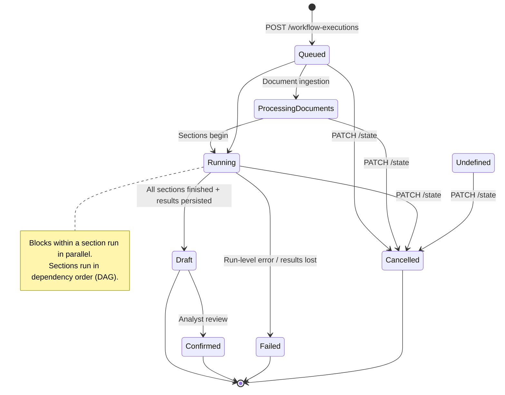
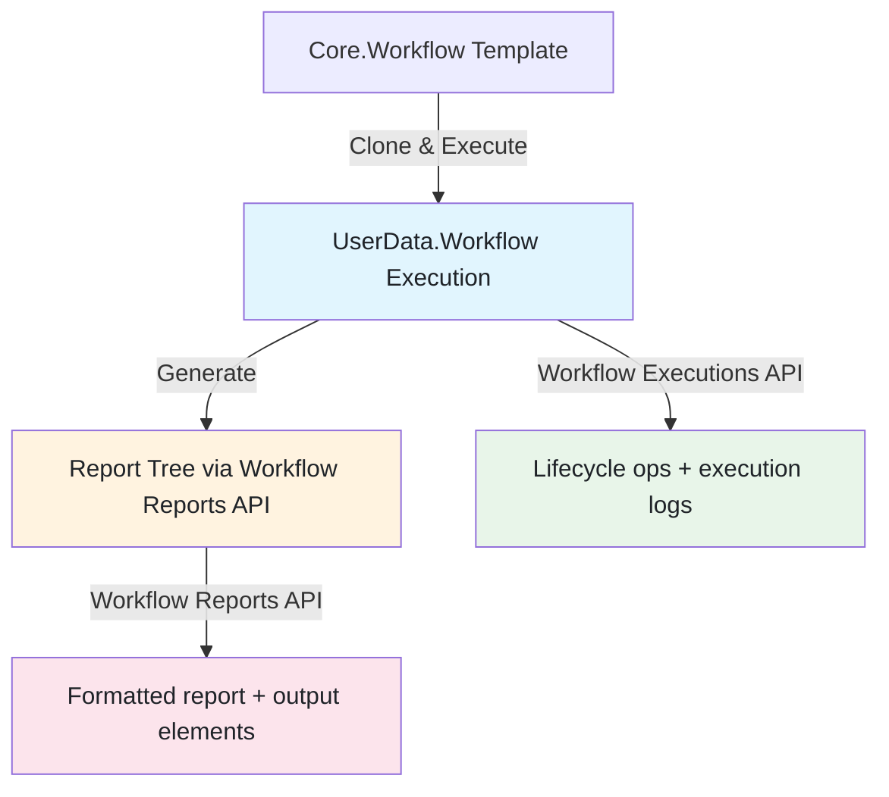

# Workflow Executions API

**On this page:** Base URL · Authentication · Workflow Execution Lifecycle · Execution vs Report Data · Endpoints · Run evidence · Retrieving Execution Output · Execution Data Structure · Real-time Updates · Workflow Execution vs Report · Error Handling

The Workflow Executions API manages the workflow execution lifecycle: starting and submitting executions, transitioning execution state, and reading per-block execution logs. It operates on executed workflow instances (UserData.Workflow). The formatted report tree produced by an execution is read through the [Workflow Reports API](reports.md) — there is no `GET /workflow-executions/{id}`.

## Base URL
`/api/v{version}/workflow-executions`

## Authentication

All endpoints inherit `[Authorize]` from the base controller and require a tenant context:

```http
Authorization: Bearer {access_token}
X-Tenant-Id: {organization_id}
Content-Type: application/json
```

The signature-test endpoints (`GET {id}/blocks`, `POST {id}/test-signature-prompt`) additionally require the `SuperAdmin` or `SignatureContributor` role.

## Workflow Execution Lifecycle

Execution state is the `WorkflowState` enum. A run is queued, optionally passes through document processing, then runs its sections. On success the execution lands in `Draft` (the analyst then reviews and `Confirmed`s it); on error it lands in `Failed`. There is no `Completed` state.

`Draft` requires more than "the sections ran": every block result must also have been **durably persisted**. A run whose results could not all be saved — a mid-run persistence failure (even one recovered by the end-of-run retry), blocks left without a terminal state, a failed final state snapshot, or an abort by the persistence circuit breaker (3 consecutive persistence failures) — ends `Failed`, with the reason appended to the execution's logs as a `Result persistence` row. See the [persistence-failure contract](../../architecture/workflow-engine/parallel-execution.md#persistence-failure-contract).



## Execution vs Report Data



The Workflow Executions API owns lifecycle operations (start, submit, state transitions) and execution logs. The rendered output of an execution — the report tree and its output elements — is read through the [Workflow Reports API](reports.md) (`GET /api/v{version}/workflow-reports/{id}`).

## Endpoints

### Start Workflow Execution

#### `POST /api/v{version}/workflow-executions`

Starts a new workflow execution from a template with optional file references and variable inputs. Returns immediately; execution proceeds on a background job.

**Request Body** (`StartWorkflowExecutionRequest`):

```json
{
  "workflowId": "CorporatesCreditReport",
  "files": [
    { "fileId": "file-123", "documentClass": "Annual Report" }
  ],
  "counterpartyId": "counterparty-456",
  "peerCompanyIds": ["peer-1", "peer-2"],
  "variables": {
    "workflowVariable_1": "value1",
    "workflowVariable_2": ["option1", "option2"],
    "workflowVariable_3": "2025-03-25"
  },
  "isConfidential": false,
  "freezeSourceExecutionId": null
}
```

| Field | Type | Required | Description |
|---|---|---|---|
| `workflowId` | string | Yes | Workflow type ID of the template to execute. |
| `files` | object[] | No | File references (`PostDocumentInfoRequest`): `fileId`, and optionally `documentClass`, `documentTags`, `shouldUseOcr` (default `false`) and `shouldBeDisplayedInOutput` (default `true`). Every `fileId` must resolve to a live document of the organization — see [Unresolvable input documents](#unresolvable-input-documents). |
| `counterpartyId` | string | No | Counterparty to associate with the execution. |
| `peerCompanyIds` | string[] | No | Peer company IDs for comparative analysis. |
| `variables` | object | No | Variable values keyed by `ReplacementTag`. |
| `isConfidential` | boolean | No | Marks the execution confidential: its documents are anonymised before any model reads them. Only the paid build anonymises. The open build refuses `true` with `400` and `WorkflowExecution.AnonymisationUnavailable` ("The platform cannot anonymise documents, so it cannot start a confidential run. Start the run with isConfidential set to false. The full edition anonymises documents before any model reads them."), and no execution starts. |
| `freezeSourceExecutionId` | string | No | The freeze option: a completed execution of the organization whose external-fetch outputs (web search, exchange rate, external API blocks) this execution replays instead of fetching live. See [Freezing external fetches](#freezing-external-fetches). |


**Response (201 Created):** a `WorkflowExecutionDto`. The `Location` header points at the corresponding report (`/api/v{version}/workflow-reports/{id}`).

```json
{
  "id": "exec-12345",
  "workflowId": "wf-internal-id",
  "workflowTypeId": "CorporatesCreditReport",
  "workflowTypeName": "Corporates Credit Report",
  "workflowState": "Queued",
  "jobId": "job-xyz789",
  "counterpartyId": "counterparty-456",
  "analystName": "jane.doe",
  "userId": "user-456",
  "isBaseline": false,
  "freezeSourceExecutionId": null,
  "freezeReplayedCount": null,
  "freezeEligibleCount": null,
  "createdAt": "2025-03-25T10:00:00Z",
  "startedAt": null,
  "completedAt": null,
  "duration": null,
  "variables": {
    "workflowVariable_1": "value1"
  }
}
```

#### Workflow access

`workflowId` must name a workflow whose type the caller's organization has access to (`WorkflowTypeOrganizationAccess`). A workflow of a type the organization cannot reach answers `404` with `Workflow not found.`, the same answer as an unknown id, and no execution starts. The id may also name the stored copy an earlier run made of its workflow; another organization's copy answers the same `404` (`RunnableWorkflowGuard.OwnCopy`). Every run start goes through this check in `WorkflowExecutionOrchestrator`: this endpoint and the [submit endpoint](submit-workflow-execution.md#system-user-requirements).


#### While a deploy replaces the server

A deploy pauses new runs for a few minutes before it replaces the server, so the reports already running get time to finish. A start in that time answers `503` with the code `RunIntake.Paused`, the header `Retry-After: 120`, and `The platform is being updated. New reports can start again in a few minutes.` Nothing starts. Start the run again after the time the header gives. A start that repeats an earlier one's idempotency key still gets the run it already has.

#### Unresolvable input documents

Every `files[].fileId` must resolve to a live document of the caller's organization. A submission naming an id that does not — the document was deleted, belongs to another organization, or never existed — is refused before any execution row exists, whatever the document class:

| Status | Code | Cause |
|---|---|---|
| 400 | `WorkflowExecution.AnonymisationUnavailable` | `isConfidential` is `true` and the build has no anonymiser (the open build). Submit the run without the flag, or run it on the paid build. |
| 400 | `WorkflowExecution.UnresolvableInputDocuments` | The description names each unresolved id. Remove those entries from the submission, or upload the files again, then resubmit. |
| 400 | `WorkflowExecution.UnresolvableCounterparties` | `counterpartyId` or an entry of `peerCompanyIds` names no counterparty of the caller's organization: it never existed or belongs to another organization. The description names each such id. Choose the counterparty and the peer companies from the organization's own list, then resubmit. |

The check is uniform across every submitter — this endpoint, re-runs, and in the full edition regression replays and validation runs — so no execution ever consumes fewer input documents than its request declared. Before it existed, an unresolvable id of a non-required document class was dropped silently and the report read as if the input had never been part of the request.

#### Freezing external fetches

`freezeSourceExecutionId` names a completed execution (`Draft` or `Confirmed`) of the caller's organization. The new execution then replays that source's outputs for every freeze-eligible block — `IntelligentSearch`, `ExchangeRate`, `WebApiCall`; agent blocks are never freeze-eligible — matched by stable block ID, and runs everything else live. The submission must match the source on workflow type, counterparty and variable values, or the start is refused:

| Status | Code | Cause |
|---|---|---|
| 404 | `WorkflowExecution.FreezeSourceNotFound` | No such execution in the organization. |
| 400 | `WorkflowExecution.FreezeSourceNotCompleted` | The source has not finished (still queued or running, failed, or cancelled), so it has no outputs to replay. `Draft` and `Confirmed` both count as finished. |
| 400 | `WorkflowExecution.FreezeSourceWorkflowTypeMismatch` | The source ran a different workflow type. |
| 400 | `WorkflowExecution.FreezeSourceCounterpartyMismatch` | The source ran for a different counterparty (or none). |
| 400 | `WorkflowExecution.FreezeSourceVariablesMismatch` | The effective variable values differ; the description and the `variables` metadata entry name the differing tags. Keys compare case-insensitively, an omitted value reads as the template default in the shape a submitted value takes (a pipe-separated list default as its items, a date without a time as midnight), a list reads the same as a pipe-separated string or an array of its items, and a number reads the same as its JSON string — but numbers compare as written, so `1.5` and `1.50` differ. The source's omitted values read as the defaults of the template it actually ran with. |

Replay is best-effort: a freeze-eligible block the source has no output for (the block is new, was restructured, or the source's executed workflow is no longer stored) **runs live**, and the execution discloses how much was replayed. Three fields carry that on every `WorkflowExecutionDto` and `WorkflowExecutionSummaryDto`, so a frozen execution is recognizable wherever executions are listed — the SPA renders them as a "Replayed" badge beside the status:

| Field | Type | Description |
|---|---|---|
| `freezeSourceExecutionId` | string | The execution replayed from; set from creation. Null on a normal execution. |
| `freezeReplayedCount` | integer | Freeze-eligible blocks served from the replay. Written when a replay run ends — a frozen execution, or in the full edition a regression rerun; null on a non-replay execution and until the run ends. |
| `freezeEligibleCount` | integer | Freeze-eligible blocks the run executed (the coverage denominator). Written when a replay run ends — a frozen execution, or in the full edition a regression rerun; null on a non-replay execution and until the run ends. |

A frozen execution is a test artifact: its exchange rates and search results are historical.


### Submit Workflow Execution

#### `POST /api/v{version}/workflow-executions/submit`

Single-call multipart endpoint that uploads files and starts an execution in one request, intended for service-to-service integrations. Returns **201 Created** with a `WorkflowExecutionDto`. See the dedicated [Submit Workflow Execution API](submit-workflow-execution.md) for the full multipart contract, idempotency, and examples.

### Get Execution Logs

#### `GET /api/v{version}/workflow-executions/{id}/logs`

Returns lightweight per-block log summaries for an execution (no prompt/output content) for fast initial loading.

**Response (200 OK):** `ListResponse<WorkflowExecutionLogSummaryDto>`. `status` is one of `NotExecuted`, `Running`, `Completed`, `Failed` or `Skipped`. `refusalCategory` is set on a row that failed because the model refused: the refusal category (such as `reasoning_extraction`), `unspecified`, or `written` for a refusal the model wrote as its answer; null on every other row.

```json
{
  "value": [
    {
      "id": "log-1",
      "sectionName": "Portfolio Analysis",
      "blockName": "Extract Portfolio Data",
      "blockType": "AiQuery",
      "replacementTag": "extractedHoldings",
      "modelUsed": "claude-sonnet-4",
      "status": "Completed",
      "error": null,
      "refusalCategory": null,
      "createdAt": "2025-03-25T10:00:10Z",
      "shouldDisplayInLogs": true,
      "hasPrompt": true,
      "hasOutput": true,
      "hasInputs": true
    }
  ]
}
```

### Get Log Entry Details

#### `GET /api/v{version}/workflow-executions/{id}/logs/{logId}`

Returns the heavy detail for a single block log (inputs, prompt, output), lazily loaded when a log item is expanded.

**Query Parameters:**

| Parameter | Type | Default | Description |
|---|---|---|---|
| `includePrompt` | boolean | `true` | Include the prompt preview and the placeholder values. |
| `includeOutput` | boolean | `true` | Include the raw block output. |

**Response (200 OK):** `WorkflowOutputExecutionLogDto`.

`prompt` is the block's prompt preview from the editor (`AiQueryProperties.UserPromptTemplatePreview`), not the prompt the run sent. It is null when the block has no preview. The prompt the run sent is `ExecutionState.UserPrompt` in the block's properties in the [executed workflow snapshot](executed-workflow-download.md), and [Get Log Placeholders](#get-log-placeholders) returns the values the run put into it.

```json
{
  "id": "log-1",
  "inputs": {
    "fund_legal_entity_name": "Emerging Markets Fund"
  },
  "prompt": "Extract top 10 holdings from {fund_legal_entity_name} portfolio",
  "promptPlaceholderValues": {
    "fund_legal_entity_name": { "value": "Emerging Markets Fund", "truncated": false }
  },
  "output": "Top 10 Holdings:\n1. Government Bonds (35%)..."
}
```

### Get Log Placeholders

#### `GET /api/v{version}/workflow-executions/{id}/logs/{logId}/placeholders`

Returns the full (non-truncated) placeholder values used in a log's prompt. Optionally filter by specific keys. The log is looked up in the caller's organization only: a log of another organization answers 404.

**Query Parameters:**

| Parameter | Type | Description |
|---|---|---|
| `placeholderKeys` | string | Optional comma-separated list of placeholder keys to return. |

**Response (200 OK):** `Dictionary<string, string>` mapping placeholder key to its full value. The keys are the `{tag}` names in the block's user prompt template (`WorkflowExecutionLogPromptResolver.ExtractPlaceholderValues`): a workflow variable's tag, or another block's tag, whose value is that block's output — for a Retrieve Data From Documents block, the text of the pages it retrieved. The pages a block retrieves through its own filter rules are sent beside the prompt, not inside it, so they are not among the keys.

```json
{
  "fund_legal_entity_name": "Emerging Markets Fund",
  "holdings_pages": "Page 18: Portfolio Holdings as of December 31, 2024...[full text]"
}
```

### Check Re-run Inputs

#### `GET /api/v{version}/workflow-executions/{id}/rerun-inputs`

Checks an execution's inputs against its workflow's current template before a re-run. A workflow can change after a run: it can gain a required variable, drop a variable, or need a document class the run did not have. Starting a re-run with the run's inputs as they are then fails with `WorkflowVariable.Required` or a `DocumentClasses` error. This endpoint tells the caller first.

The check applies the same variable rules and document class rules as `POST /workflow-executions`, so `isReady: true` means a start with `workflowId`, `variables` and the run's input documents is accepted. The run's input documents are the documents its report lists as input: excluded documents and documents of an output class are left out. Confidential values are never returned: a confidential variable the run had a value for is listed in `variablesNeedingInput` with the reason `Confidential`, required or not, so a re-run never drops it without the user knowing. The check covers variables and documents only: a start can still be refused for a reason in the template itself, such as an Agent block the deployment cannot run.

The execution is looked up in the caller's organization only. The current template is the newest one of the execution's workflow type, and the organization must have access to that type.

**Response (200 OK):** `ReRunInputsDto`.

```json
{
  "workflowId": "6ad2a981-09bf-4c2d-b402-9bbca9d89ead",
  "workflowTypeId": "BankAccountAnalysis",
  "isReady": false,
  "variables": [
    { "replacementTag": "CompanyName", "value": "Acme Ltd" },
    { "replacementTag": "Currency", "value": "USD" }
  ],
  "variablesNeedingInput": [
    {
      "replacementTag": "account_holder_type",
      "displayName": "Account Holder",
      "reason": "NoValue",
      "message": "Required variable 'Account Holder' (account_holder_type) is missing."
    }
  ],
  "defaultedVariables": [{ "replacementTag": "Currency", "displayName": "Currency" }],
  "removedVariables": [{ "replacementTag": "Region", "displayName": "Region" }],
  "documentClassesNeedingInput": [],
  "unavailableDocuments": []
}
```

| Field | Meaning |
|---|---|
| `workflowId` | The current template's id. Submit the re-run with it. |
| `isReady` | True when nothing is listed in `variablesNeedingInput`, `documentClassesNeedingInput` or `unavailableDocuments`. |
| `variables` | The values to submit, keyed by the current template's `replacementTag`: the run's value for each variable the template still has, and the template's default for a variable the run had no value for. A variable that needs input is absent. The list shape keeps tag casing, which a dictionary would lose to the API's camelCase key policy. |
| `variablesNeedingInput` | Variables the user must fill in. `reason` is `NoValue` (no value and no default, typically a variable added after the run), `InvalidValue` (the run's value no longer passes the variable's rules, for example a removed dropdown option) or `Confidential`. `message` is the error a start without a usable value gets. |
| `defaultedVariables` | Variables that take the template's default because the run had no value for them. |
| `removedVariables` | Variables of the run that the template no longer has. Their values are dropped. |
| `documentClassesNeedingInput` | Document classes the run's input documents no longer satisfy, with the start endpoint's message. On a type that classifies its own documents, only the classes the screening stage cannot settle are listed, as on a start. |
| `unavailableDocuments` | Input documents (`documentId`, `fileName`) that no longer exist in the organization, for example deleted after the run. `fileName` is the name the app shows for the document, and null when the document row is gone. A start that names them is refused, so a re-run leaves them out, and they do not count toward `documentClassesNeedingInput`. |

`404 Not Found` when the execution does not exist in the organization, and with code `WorkflowExecution.ReRunWorkflowNotAvailable` when the workflow type has no template, is not available, or the organization has no access to it.

The SPA calls this before both re-run choices. See [Re-running a report](#re-running-a-report-from-the-spa).

#### Re-running a report from the SPA

The report's **Edit & Re-run** opens a choice. **Restart with same inputs** calls the check first: when `isReady` is true it starts the run with the check's `variables`, and the toast names the dropped and defaulted variables; when it is false it opens the create form on the first step with something to fill in, with the original values and the documents that still exist filled in, the fields to fill marked, and a note that lists what changed. **Edit inputs first** always opens the form, with the same marks and note. An API without this endpoint answers 404 with no body, and the SPA then re-runs with the report's inputs as before; any other error of the check is shown and nothing starts. A start refused with `WorkflowVariable.*` (the workflow changed between the check and the start, or the check was not there) opens the same form on the details step with the toast "This workflow has changed since the original run. Fill in the new fields to re-run it."


### Update Execution State

#### `PATCH /api/v{version}/workflow-executions/{id}/state`

Transitions an execution to a new state. Currently only **`Cancelled`** is supported, and only from an active state — `Running`, `ProcessingDocuments`, `Queued`, or `Undefined` (the creation default, still held by legacy rows); any other transition returns 400. If the execution has an active background job, that job is signalled to stop.

**Request Body** (`UpdateWorkflowExecutionStateRequest`):

```json
{ "state": "Cancelled" }
```

**Response:** `204 No Content` on success; `400 Bad Request` if the target state is unsupported, or with `WorkflowExecution.NotCancellable` (`Workflow execution in state '{state}' cannot be cancelled.`) if the current state cannot transition or the run reached a terminal state during the cancel; `404 Not Found` with `WorkflowExecution.NotFound` if the execution does not exist in the organization.

### Get Execution Blocks (signature-test playground)

#### `GET /api/v{version}/workflow-executions/{id}/blocks`

**Roles:** `SuperAdmin` or `SignatureContributor`.

Returns every AI Query block from a persisted execution snapshot with its captured output and the resolved signature-field values used at execution time. Prompts are deliberately omitted. Consumed by the signature-test-replay picker.

**Response (200 OK):** `ExecutionBlocksDto` (`workflowExecutionId`, `workflowTypeId`, `blocks[]` — each with `blockId`, `blockName`, `sectionTitle`, `replacementTag`, `rawResponse`, and replayable `signatureFields`).

### Test Signature Prompt

#### `POST /api/v{version}/workflow-executions/{id}/test-signature-prompt`

**Roles:** `SuperAdmin` or `SignatureContributor`.

Replays a single AI Query block from a past execution with one signature value swapped for a user-supplied test value. The AI provider is called directly with the modified prompt; no new execution, RAG, or downstream blocks run.

**Request Body** (`TestSignaturePromptRequest`):

```json
{
  "blockId": "block-1",
  "placeholderName": "riskAppetite",
  "testValue": "Conservative"
}
```

**Response (200 OK):** `SignaturePromptTestResultDto` — the resolved signature values, response text, and metadata. The modified prompt itself stays server-side.

## Run evidence

A scripted test run reads back what its run did through three endpoints, beside the
[executed workflow download](executed-workflow-download.md). They share one access
rule (`RunEvidenceAccess`): an `Operator` or `SuperAdmin` reads any run in the organization; the
organization's service user (`User.IsSystem`) reads a run it started; every other caller gets
403, because traces carry prompts and document text. A run in another organization answers 404.
Trace rows are found through the block's executed workflow and filtered by the organization the
row was stamped with, so a row of another organization never answers.

### List agent run files

#### `GET /api/v{version}/workflow-executions/{id}/agent-runs`

Returns `{ "value": [AgentRunFileDto] }`, one entry per collected file: `blockId`, `blockName`,
`replacementTag` (a looped or parameterized copy carries its own, such as `Item_echo_0` or
`summary_N`), `runExecutionId`, `attempt`, `path` (`trace/...` or `out/...`), `sizeBytes`,
`sha256`, `collectedAt`. Ordered by section, block, run, attempt and path.

### Download an Agent block's trace

#### `GET /api/v{version}/workflow-executions/{id}/agent-runs/{blockId}/trace`

Serves `trace/trace.ndjson` as `application/x-ndjson`. Without `runExecutionId` the block's most
recently collected run answers (in the full edition, a block a verification group redid bought one run per round);
`attempt` selects one collection attempt. 404 when the block has no trace in this run.

### Download one agent run file

#### `GET /api/v{version}/workflow-executions/{id}/agent-runs/{blockId}/file?path=out/result.json`

The same selection as the trace endpoint, for any path the list returns.

### Where the prompt and input context live

The block log detail (`GET {id}/logs/{logId}`) carries an AI Query block's resolved prompt and
placeholder values. Every other block's rendered inputs, an Agent block's rendered skills and
prompt included, live in the executed workflow: download it and read the block's
`Properties.ExecutionState`. The trace is where the model's turns, tool calls and `usage` live.


### Agent activity digest

#### `GET /api/v{version}/workflow-executions/blocks/{blockId}/agent-activity`

The paced, client-facing activity feed of an executed Agent block, projected from its persisted trace pack; it never serves raw trace content, so it carries no role gate. `?round=N` selects the run the full edition's verification group bought in that round, `?runExecutionId=` selects one run and outranks the round; without either the last-collected run answers. A block without a collected trace, or one outside the caller's organization, answers an empty digest rather than an error. `beatSource` is accepted and ignored.

### Graph provenance

`POST /api/v{version}/workflow-executions/{runId}/graph/query` and `GET /api/v{version}/workflow-executions/{runId}/graph/validate/{targetTag}` serve the Graph-RAG provenance query over a run; see [Tracer agent](../../architecture/tracer-agent/index.md).


## Retrieving Execution Output

There is no `GET /workflow-executions/{id}`. To read what an execution produced, use the [Workflow Reports API](reports.md):

- `GET /api/v{version}/workflow-reports/{id}` — the execution itself: its state, failure, documents and timing. Poll it after a start.
- `GET /api/v{version}/workflow-reports/{id}/elements` — the report tree of sections and paragraphs.

## Execution Data Structure

### Workflow Instance Types

| Type | Description | Location |
|------|-------------|----------|
| Template | Blueprint workflow definition | Core.Workflow |
| ExecutionInstance | Cloned instance with execution data | UserData.Workflow |

### Execution States (`WorkflowState`)

| State | Description |
|-------|-------------|
| Undefined | State not set. |
| Queued | Waiting for a worker to dequeue it. |
| ProcessingDocuments | Ingesting/processing input documents. |
| Running | Sections are executing. |
| Draft | All sections finished and every block result was durably persisted; awaiting analyst review. |
| Confirmed | Reviewed and confirmed by an analyst. |
| Failed | Execution failed with errors, finished with lost/unpersistable results, or was aborted by the persistence circuit breaker. |
| Cancelled | Cancelled by a user or the system. |

### Block Execution States (`BlockExecutionStatus`)

| State | Description |
|-------|-------------|
| NotExecuted | Block has not run yet. |
| Running | Block is currently executing. |
| Completed | Block finished successfully. |
| Failed | Block failed with an error. |
| Skipped | Block was skipped (e.g. required documents missing). |

## Real-time Updates

The Workflow Executions API pushes no progress: there is no SignalR hub, and `POST /hubs/execution/negotiate` answers `404`. Poll `GET /api/v{version}/workflow-reports/{id}` for `workflowState` until it reaches a final state. The SPA's polls are on [Realtime and polling](../../architecture/frontend/realtime-and-polling.md).

## Workflow Execution vs Report

| Aspect | Workflow Execution | Report |
|--------|-------------------|---------|
| **API** | `/workflow-executions` | `/workflow-reports` |
| **Data** | Lifecycle, state, execution logs | Formatted report tree + output elements |
| **Storage** | UserData.Workflow + execution logs | UserData report/output-element tables |
| **Content** | Operational execution detail | Business-ready presentation |
| **Audience** | Integrators, system admins | Business users |

## Error Handling

Endpoints return an `ErrorOr` result, rendered as RFC 7807 problem details in the shape every API uses ([Error Handling](index.md#error-handling)); validation failures come back as `ValidationProblemDetails` keyed by error code. For example, a cancel of an execution the organization does not hold:

```json
{
  "type": "https://tools.ietf.org/html/rfc9110#section-15.5.5",
  "title": "Workflow execution not found.",
  "status": 404,
  "code": "WorkflowExecution.NotFound",
  "traceId": "00-..."
}
```
