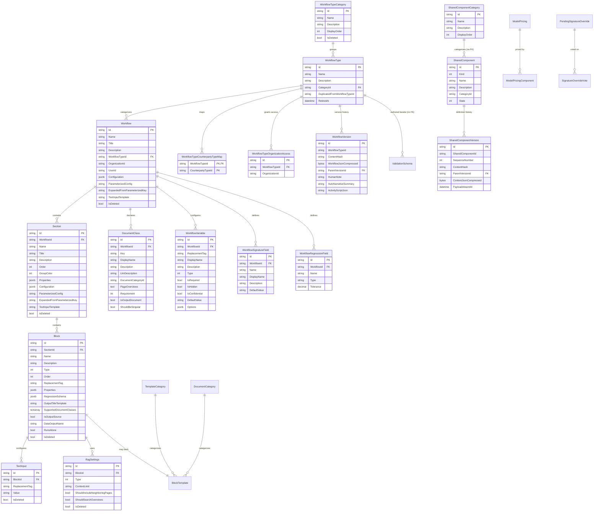

# Core Database Schema

**On this page:** Schema: `Core` · Comprehensive Entity Relationship Diagram · Core Entities · AI Processing Configuration · JSON Configuration Patterns · Performance Optimization · Migration Considerations

The Core database contains system-wide configuration, reusable workflow **templates**, and AI processing prompt configurations. Templates authored here are the canonical definitions that executions are produced from; a `WorkflowType` is shared across the **set** of organizations granted access to it (via `WorkflowTypeOrganizationAccess`), not duplicated per organization.

## Schema: `Core`

The Core database uses the `Core` schema to namespace all tables and maintain clear separation from tenant execution data, which lives in the [UserData database](user-data-database.md). Each context reads its own connection string, `CoreDbConnection` and `UserDataDbConnection` (`DatabaseConfigurator`), so one PostgreSQL or SQL Server instance may host both schemas, or they may be split across servers.

> The template entity classes (`Workflow`, `Section`, `Block`, `TextInput`, `RagSettings`, `DocumentClass`, `WorkflowVariable`, `WorkflowSignatureField`, `WorkflowRegressionField`) are **shared** between the Core and UserData contexts. In Core they hold authoring-time templates; in UserData they hold immutable executed snapshots. `CounterpartyType` is **not** a Core table — it lives in the UserData schema. Core only stores the `WorkflowTypeCounterpartyTypeMap` join that links a workflow type to counterparty types.

## Comprehensive Entity Relationship Diagram



## Core Entities

### Workflow Templates

#### Workflows
**Purpose**: Template workflow definitions that serve as blueprints for executed instances.

| Column | Type | Description |
|--------|------|-------------|
| `Id` | string (PK) | Unique workflow identifier |
| `Name` | string | Internal workflow name |
| `Title` | string | Display title for UI |
| `Description` | string | Workflow description and purpose |
| `Notes` | text (nullable) | What the workflow is for and how it should work, in plain words: purpose and readers, what each section should produce, conventions, client rules, known weak spots. Saved with the workflow in the same version; the [editor agent](../../features/editor-agent.md) reads it and keeps it current. Nothing reads it at run time. Also on executed copies in UserData. |
| `WorkflowTypeId` | string (FK) | Reference to the workflow type |
| `OrganizationId` | string | "Who last saved" stamp — **not** an ownership/scoping key |
| `UserId` | string | Last author |
| `Configuration` | jsonb | Workflow-level settings |
| `ParameterizedConfig` | text | Source config for parameterized expansion |
| `ExpandedFromParameterizedKey` | text | Set when this workflow was expanded from a parameterized template |
| `TextInputTemplate` | text | Template text-input payload |
| `CreatedAt` / `UpdatedAt` | datetime | Audit timestamps |
| `DeletedAt` / `DeletedByUserId` / `UpdatedByUserId` | — | Audit fields |
| `IsDeleted` | boolean | Soft delete flag |

**Key Features**:
- A workflow owns an ordered collection of `Section`s; blocks live under sections, not directly under the workflow.
- `OrganizationId` is a last-saver stamp. Access to a template is gated by `WorkflowTypeOrganizationAccess` (does the caller's org have access to the *type*?), never by filtering `Workflow.OrganizationId`.
- A `WorkflowVariable` is persisted as an **owned collection** of the workflow (table `WorkflowVariable`), keyed by `WorkflowId`; it has no independent audit/soft-delete columns.

> The workflow hierarchy is `Workflow → Section → Block`. The workflow is the root and does not self-reference — `Section` is a first-class entity carrying `Order`, `GroupColor`, and the separator flag.

#### WorkflowVariable
**Purpose**: The run inputs a workflow asks for. Owned by the workflow (EF Core `OwnsMany`), so a row has no audit or soft-delete columns and is deleted with its workflow.

| Column | Type | Description |
|--------|------|-------------|
| `Id` | string (PK) | Identifier |
| `WorkflowId` | string (FK) | Owning workflow |
| `ReplacementTag` | string(450) | Placeholder name blocks use to read the value |
| `DisplayName` | string(1000) | Label shown on the run form |
| `Description` | text | Help text |
| `Type` | integer (enum) | `WorkflowVariableTypes`: `String` (0), `Number` (1), `DateTime` (2), `List` (3), `Dropdown` (4), `MultiSelect` (5) |
| `IsRequired` / `IsHidden` / `IsConfidential` | boolean | Run-form flags |
| `DefaultValue` | text (nullable) | Default value |
| `Options` | jsonb | Option key → label, for `Dropdown` and `MultiSelect` |

#### WorkflowSignatureField
**Purpose**: A signature field defined on the workflow. A block uses the field by carrying the `{Name}` token in its templates; nothing is stored on the block, so one field can serve many blocks and survives block restructuring. Client values live in `SignatureFieldOverrides`, keyed by `Name` ([Signature field overrides](../../features/signature-overrides.md)).

| Column | Type | Description |
|--------|------|-------------|
| `Id` | string (PK) | Identifier |
| `WorkflowId` | string (FK) | Owning workflow (cascade delete) |
| `Name` | string(200) | Placeholder name; unique per workflow, case-insensitive, enforced by save validation |
| `DisplayName` | string(450) | Display name |
| `Description` | text | Description |
| `DefaultValue` | text | Value used when the organization has no override |

#### WorkflowRegressionField
**Purpose**: A regression metric defined on the workflow: name, type and tolerance. The block that produces the value carries only a binding in `Blocks.RegressionSchema`, keyed by `Name`, so deleting a block leaves the definition in place to be bound again.

| Column | Type | Description |
|--------|------|-------------|
| `Id` | string (PK) | Identifier |
| `WorkflowId` | string (FK) | Owning workflow (cascade delete) |
| `Name` | string(450) | Field name; unique per workflow, case-insensitive, enforced by save validation |
| `Type` | string(50) | `numeric` or `text` |
| `Tolerance` | decimal(28,8) | Percentage tolerance for numeric comparison (5 means ±5%); ignored for text |

#### Sections
**Purpose**: Ordered grouping of blocks within a workflow template. Each section is owned by exactly one workflow.

| Column | Type | Description |
|--------|------|-------------|
| `Id` | string (PK) | Unique section identifier |
| `WorkflowId` | string (FK) | Parent workflow template |
| `Name` | string | Internal section name |
| `Title` | string | Display title for UI |
| `Description` | string | Section description |
| `Order` | integer | Section sequence within the workflow |
| `GroupColor` | integer (nullable) | Optional grouping colour for the editor |
| `Properties` | jsonb | Serialized `SectionProperties` (carries the `IsSeparator` and `ExcludeFromWordExport` flags) |
| `StableSectionId` | string (nullable) | Permanent authoring identity minted when the section is created; preserved by execution clones, re-minted on authoring copies (duplicate or copy to another workflow) |
| `SharedComponentId` | string (nullable, indexed) | Library component this section is a copy of; null = plain local section. Copied verbatim by every clone path, never re-minted |
| `SharedComponentLinkState` | integer (enum, nullable) | `Linked` (live copy) or `BrokenOut` (forked with provenance) |
| `SharedComponentVersionHash` | string(64) (nullable) | Component version materialized onto this copy; frozen at break-out |
| `SharedComponentBindings` | jsonb (nullable) | Definition slot tag → instance tag map written at materialization |
| `SharedComponentSlotStates` | jsonb (nullable) | Slot tag → per-entry override on a linked section copy: `Hidden` (definition entry suppressed in this workflow) or `BrokenOut` (slot forked while the section stays linked); null = no overrides |
| `Configuration` | jsonb | Section-level configuration |
| `ParameterizedConfig` | text | Source config for parameterized expansion |
| `ExpandedFromParameterizedKey` | text | Set when this section was expanded from a parameterized template |
| `TextInputTemplate` | text | Template text-input payload |
| `CreatedAt` / `UpdatedAt` | datetime | Audit timestamps |
| `IsDeleted` | boolean | Soft delete flag |

**Key Features**:
- Sections carry the `Order` and `GroupColor` that previously lived on the root workflow.
- A separator is a section flagged via `Properties.IsSeparator`; separator sections hold no blocks.
- `Block.SectionId` is nullable by design — transient or orphaned blocks may have no parent section.
- The parameterized columns support expanding one section into many at execution time.

#### Blocks
**Purpose**: Individual workflow step templates with configurable execution strategies.

| Column | Type | Description |
|--------|------|-------------|
| `Id` | string (PK) | Unique block identifier |
| `SectionId` | string (FK, nullable) | Parent section |
| `Name` | string | Block display name |
| `Description` | string | Block description |
| `Type` | integer (enum) | Block execution strategy (`BlockTypes` enum, stored as int) |
| `Order` | integer | Execution sequence within the section |
| `ReplacementTag` | string | Tag used to reference this block's output in templates |
| `Properties` | jsonb | Strongly-typed block configuration |
| `RegressionSchema` | jsonb (nullable) | Schema used for regression comparison |
| `StableBlockId` | string (nullable) | Permanent cross-instance block identity; survives execution cloning, suffixed on loop/parameterized expansion, re-minted on authoring copies. Pairs baseline and rerun blocks in regression testing |
| `SharedComponentId` | string (nullable, indexed) | Library component this block is a copy of; null = plain local block. Copied verbatim by every clone path, never re-minted or suffixed |
| `SharedComponentLinkState` | integer (enum, nullable) | `Linked` (live copy) or `BrokenOut` (forked with provenance) |
| `SharedComponentVersionHash` | string(64) (nullable) | Component version materialized onto this copy; frozen at break-out |
| `SharedComponentBindings` | jsonb (nullable) | Definition slot tag → instance tag map written at materialization |
| `OutputTitleTemplate` | string (nullable) | Template for the output element title |
| `SupportedDocumentClasses` | text[] | Document classes this block consumes |
| `CounterpartyResultType` | integer (nullable) | How the block result maps to a counterparty |
| `IsOutputSource` | boolean | Whether the block contributes to workflow output |
| `DataOutputName` | string (≤100, nullable) | The name the block's JSON is sent under as a data output, beside the report; null when the block is not one |
| `RunsAlone` | boolean | Forces isolated execution |
| `ShouldDisplayInLogs` | boolean | Log visibility |
| `ShouldUpdateCounterpartyWithResult` | boolean | Writes the result back onto the counterparty |
| `UpdateCounterpartyPropertyKey` | string (nullable) | The counterparty property the result is written to when `CounterpartyResultType` is `Property`; with no key the write is skipped and a warning logged |
| `CreatedAt` / `UpdatedAt` | datetime | Audit timestamps |
| `IsDeleted` | boolean | Soft delete flag |

**Block types**: `Type` stores a `BlockTypes` value as an integer, numbered with gaps: `AiQuery` 0, `Merge` 3, `CalculateNumber` 6, `SimpleRag` 9, `LoopStart` 10, `LoopEnd` 11, `BuildTopicsForAllDocuments` 15, `IntelligentSearch` 19, `ExchangeRate` 20, `WebApiCall` 21, `DynamicChart` 23, `Json2Xlsx` 24, `SwitchCase` 25, `MergeJson` 26, `StringManipulation` 27, `Agent` 28, `PeerFinancials` 29, `Verification` 30. What each type does is in the [Block reference](../../guides/blocks/block-reference.md).

#### TextInputs
**Purpose**: Configurable parameter values for block templates with placeholder replacement.

| Column | Type | Description |
|--------|------|-------------|
| `Id` | string (PK) | Unique text input identifier |
| `BlockId` | string (FK) | Parent block template |
| `ReplacementTag` | string | Placeholder identifier for substitution |
| `Value` | string (nullable) | Template value with placeholders |
| `CreatedAt` / `UpdatedAt` | datetime | Audit timestamps |
| `IsDeleted` | boolean | Soft delete flag |

#### RagSettings
**Purpose**: Retrieval-Augmented Generation configuration for a block. Configuration is stored as explicit typed columns, not as a single JSON blob.

| Column | Type | Description |
|--------|------|-------------|
| `Id` | string (PK) | Unique RAG settings identifier |
| `BlockId` | string (FK) | Associated block template |
| `Type` | integer (enum) | RAG strategy (`RagTypes` enum, stored as int) |
| `ContextLimit` | string | Token/context budget expression |
| `IterationLimit` | string | Max iterations for agentic retrieval |
| `NumberOfPagesInput` | string | "Top N" page count expression |
| `StartIndexInput` / `EndIndexInput` | string | Page range bounds |
| `ExactIndexesInput` | string | Explicit page indexes |
| `PageAdjustmentInput` | string | Neighbor/offset adjustment |
| `Keywords` | text[] | Keyword filter terms |
| `SmartFilterExpressions` | text[] | Filter expressions |
| `QueryTemplate` | text (nullable) | Semantic query template |
| `TopicsQuery` | text (nullable) | Topic-based query |
| `TableOfContentsInput` | text (nullable) | TOC selection input |
| `ShouldIncludeNeighboringPages` | boolean | Include surrounding pages |
| `ShouldSearchOverviews` | boolean | Search page overviews |
| `ShouldFilterKeyWordsExclusively` | boolean | Require all keywords |
| `CreatedAt` / `UpdatedAt` | datetime | Audit timestamps |
| `IsDeleted` | boolean | Soft delete flag |

**RAG Strategies**: `Type` stores a `RagTypes` value as an integer:
- `WholeDocument` (0) — process the entire document / all pages
- `TopNPages` (1) — top N semantically closest pages
- `TopNPagesPerFilterWithTwoNeighbors` (2) — top N pages plus their neighbors
- `TopPage` (3) — single top page
- `TopPageWithNFollowingPages` (4) — top page plus N following pages
- `NPagesStartingFromIndex` (5) — N pages from a starting index
- `KeywordBased` (6) — pages matching keywords
- `ExactPages` (7) — exact pages from dynamic input
- `UseTableOfContents` (8) — rebuild via a supplied table of contents
- `UseAutoDetectedTableOfContents` (10) — auto-detect a table of contents
- `RagAgent` (11) — iterative page selection with reasoning

### Workflow Classification

#### WorkflowTypes
**Purpose**: Categorization and string identity of workflow templates. `WorkflowTypeId` is the cross-instance identity carried in both Core and UserData.

| Column | Type | Description |
|--------|------|-------------|
| `Id` | string(100) (PK) | Unique workflow type identifier |
| `Name` | string(250) | Type name |
| `Description` | string (nullable) | Type description |
| `CategoryId` | string (FK, nullable) | Parent category |
| `DuplicatedFromWorkflowTypeId` | string(100) (nullable, indexed) | The type this one was duplicated from, set by the duplicate-type command. A duplicate keeps every `StableBlockId`, so the [editor agent](../../features/editor-agent.md) follows these links to read the runs of the whole family |
| `RetiredAt` | datetime (nullable) | When the one organization that could reach the type deleted it through the template API. The weekly cleanup removes a type only when this is set: [Retired workflow types](../../operations/soft-delete-cleanup.md#retired-workflow-types) |

This table carries no audit or `IsActive` columns — only the six fields above.

#### WorkflowTypeCategories
**Purpose**: Flat organization of workflow types.

| Column | Type | Description |
|--------|------|-------------|
| `Id` | string (PK) | Unique category identifier |
| `Name` | string | Category name |
| `Description` | string (nullable) | Category description |
| `DisplayOrder` | integer (nullable) | Display order |
| `CreatedAt` / `UpdatedAt` | datetime | Audit timestamps |
| `IsDeleted` | boolean | Soft delete flag |

There is no `ParentId` — categories are flat, not a self-referencing hierarchy.

#### WorkflowTypeCounterpartyTypeMap
**Purpose**: Join table mapping a workflow type to the counterparty types it works with.

| Column | Type | Description |
|--------|------|-------------|
| `WorkflowTypeId` | string (PK, FK) | Workflow type |
| `CounterpartyTypeId` | string (PK) | Counterparty type (defined in the UserData schema) |

This is a pure composite-key join — no surrogate `Id`, audit, or `IsActive` columns.

#### WorkflowTypeOrganizationAccess
**Purpose**: Grants an organization access to a shared workflow type. This is the isolation boundary for templates.

| Column | Type | Description |
|--------|------|-------------|
| `Id` | string (PK) | Unique access-grant identifier |
| `WorkflowTypeId` | string (FK) | Workflow type the org may access |
| `OrganizationId` | string | Organization granted access |
| `CreatedAt` / `UpdatedAt` | datetime | Audit timestamps |
| `IsDeleted` | boolean | Soft delete flag |

A unique index on `(WorkflowTypeId, OrganizationId)` enforces one grant per pair.

### Template Versioning

#### WorkflowVersions
**Purpose**: Append-only version history of workflow templates, keyed by workflow type. Version history is **universal** — one chain per workflow type, shared by every organization granted access to the type; per-organization read authorization comes from `WorkflowTypeOrganizationAccess`.

| Column | Type | Description |
|--------|------|-------------|
| `Id` | string (PK) | Unique version identifier |
| `WorkflowTypeId` | string | Workflow type the version belongs to |
| `ContentHash` | string(64) | Hash of the canonicalized template content (dedupes no-op saves) |
| `WorkflowJsonCompressed` | bytea (nullable) | Gzip-compressed snapshot of the template JSON |
| `ParentVersionId` | string (FK, nullable) | Previous version in the lineage |
| `HumanNote` | text (nullable) | Optional note stored with the version; an editor save that carries accepted [editor agent](../../features/editor-agent.md) changes writes "N changes proposed by the editor agent" and the agent's overview of each proposal |
| `AutoNarrativeSummary` | text (nullable) | Generated change summary |
| `ActivityScriptJson` | text (nullable) | The version's cached activity script: plain-language step lines that a running execution's activity view resolves against. A background pass writes it on the first submission that finds it empty and never changes it; a pass that declines stores a decline marker, so later submissions stop retrying. Null until then. Retention trimming leaves it |
| `PayloadTrimmedAt` | datetime (nullable) | When the compressed payload was pruned |
| `CreatedAt` / `CreatedByUserId` | — | Authoring audit |
| `IsDeleted` | boolean | Soft delete flag |

`ParentVersionId` self-references to form the lineage; indexes exist on `ContentHash`, `ParentVersionId`, and `(WorkflowTypeId, CreatedAt)`. Optimistic concurrency on save is enforced against the type's current head.

### Shared Components

One global Library pool per deployment — no organization scoping by design (staff-authored; write surfaces are role-gated). See [Shared Components](../../architecture/workflow-engine/shared-components.md) for the full model.

#### SharedComponents
**Purpose**: Registry entry for a Library component. Identity and lifecycle only — the definition content lives exclusively in the head version's payload.

| Column | Type | Description |
|--------|------|-------------|
| `Id` | string (PK) | Component identity, carried by consumer copies as `SharedComponentId` |
| `Kind` | integer (enum) | `Block` or `Section`; immutable after creation |
| `Name` | string(250) | Display name (not unique — content dedup is by hash) |
| `Description` | text (nullable) | Description |
| `CategoryId` | string(450) (nullable) | Curated category the component files under; plain string against `SharedComponentCategories`, no FK — validated at the write mouths. `null` = uncategorized legacy row |
| `State` | integer (enum) | `Active` or `Retired`; components are retired, never soft-deleted |
| `CreatedAt` / `UpdatedAt` | datetime | Audit timestamps |
| `IsDeleted` | boolean | Soft delete flag (never set by design) |

#### SharedComponentVersions
**Purpose**: Append-only chain of a component's definition content. Rows are never deleted or retention-trimmed — the head payload IS the definition.

| Column | Type | Description |
|--------|------|-------------|
| `Id` | string (PK) | Unique version identifier |
| `SharedComponentId` | string(450) | Owning component (plain string, no FK) |
| `SequenceNumber` | integer | Chain position; unique per component — the head is the highest value (CreatedAt is never an ordering key: batch imports can tie on it) |
| `ContentHash` | string(64) | SHA-256 of the canonical normalized definition JSON; deliberately non-unique |
| `ParentVersionId` | string (FK, nullable) | Self-referencing lineage edge (`NO ACTION`) |
| `ContentJsonCompressed` | bytea (nullable) | Gzip-compressed definition JSON |
| `PayloadAbsentAt` | datetime (nullable) | Set on hash-only rows from shallow transfer imports; readers must check this, not payload length. The head row is never payload-absent |
| `CreatedAt` / `CreatedByUserId` | — | Authoring audit |
| `IsDeleted` | boolean | Soft delete flag (never set by design) |

Indexes: unique `(SharedComponentId, SequenceNumber)` (head selection + structural chain linearity + clean concurrent-append conflicts), non-unique `ContentHash`, and `ParentVersionId`.

#### SharedComponentCategories
**Purpose**: The Library's curated category vocabulary — the flat browse spine components file under. Rows are editor-curated (no code constants beyond the initial seed).

| Column | Type | Description |
|--------|------|-------------|
| `Id` | string (PK) | Stable kebab-case id, referenced by `SharedComponents.CategoryId` without a FK |
| `Name` | string(250) | Display name |
| `Description` | string(1000) (nullable) | Description |
| `DisplayOrder` | integer (nullable) | Vocabulary display ordering |

Referential integrity is application-enforced: re-categorization validates the id against this table, and the delete endpoint refuses (`SharedComponent.CategoryInUse`) while any component references the entry — dangling category ids are structurally impossible.

### Document Classes

#### DocumentClasses
**Purpose**: Declares the document classes a workflow consumes or produces.

| Column | Type | Description |
|--------|------|-------------|
| `Id` | string (PK) | Unique identifier |
| `WorkflowId` | string (FK) | Owning workflow |
| `Key` | string | Stable key for the class |
| `DisplayName` | string | Display name |
| `Description` | string | Description shown to people: pickers, uploads, reports |
| `LlmDescription` | text (nullable) | What qualifies a document as this class, written for a model rather than a person: distinguishing features, near-miss classes, what it is not. Read by any model that reads classes; the intake screening judge is the first. Absent from the template JSON when unset, so an untouched template's content hash does not move |
| `DocumentCategoryId` | string (nullable) | Associated document category |
| `PageOverviews` | text (nullable) | The class's page overview prompts as JSON (`PageOverviewPrompts`: `pages` and `singlePage`, each a system prompt, a user prompt and the advanced-model flag); null when the class uses the workflow default. Absent from the template JSON when empty, so an untouched template's content hash does not move ([Overview generation](../../architecture/rag/overview-generation.md)) |
| `Requirement` | integer (enum) | `DocumentClassRequirement`: `Required` (0), `Suggested` (1) or `Optional` (2) |
| `IsOutputDocument` | boolean | Produced rather than consumed |
| `ShouldBeSingular` | boolean | Expect exactly one document |
| `CreatedAt` / `UpdatedAt` | datetime | Audit timestamps |
| `IsDeleted` | boolean | Soft delete flag |

### Retired: Prompt Library tables

`BlockTemplate` and `TemplateCategories` belonged to the Prompt Library, which the platform removed. At startup, `PageOverviewPromptsMigration` moves what the library resolved to into workflows and Tools Settings, then hard-deletes every `BlockTemplate` row together with its backing `Blocks` row, soft-deleted rows included. Nothing reads or writes `TemplateCategories`; its rows stay. Their columns, for reading an old backup:


#### BlockTemplate
**Purpose**: A prompt template for one document-processing step. Shares its `Id` with a backing `Block` row (1:1).

| Column | Type | Description |
|--------|------|-------------|
| `Id` | string (PK, FK→Block) | Identifier, shared with the backing block |
| `BlockType` | integer (enum) | Block type |
| `TemplateCode` | string (unique) | Stable lookup code |
| `CategoryId` | string (FK) | `TemplateCategory` |
| `DocumentCategoryId` | string (FK, nullable) | `DocumentCategory` |
| `WorkflowTypeId` | string (nullable) | Associated workflow type |
| `OrganizationId` | string (nullable) | Owning org (null for system templates) |
| `TemplateScope` | integer (enum) | `Prompt` (1) or `Block` (2); every template the platform creates is `Prompt` |
| `IsPublicTemplate` / `IsSystemTemplate` | boolean | Publicity flags |
| `ParentTemplateId` | string (FK, nullable) | Parent template for derivation |
| `TemplateVersion` | integer | Starts at 1; an import that changes the template adds 1 |
| `TemplateUsageCount` | integer | Default 0; no code increases it |
| `CreatedAt` / `CreatedByUserId` | — | Authoring audit |
| `IsDeleted` | boolean | Soft delete flag |

A check constraint requires system templates to be public and org-less.

#### TemplateCategories
**Purpose**: Self-referencing category tree for block templates.

| Column | Type | Description |
|--------|------|-------------|
| `Id` | string (PK) | Identifier |
| `Name` | string | Category name |
| `ParentCategoryId` | string (FK, nullable) | Parent category |
| `DisplayOrder` | integer | Display order |
| `CreatedAt` / `CreatedByUserId` | — | Authoring audit |
| `IsDeleted` | boolean | Soft delete flag |

### Document Categories

#### DocumentCategories
**Purpose**: Flat categories that classify documents and document classes. Live, not part of the retired library: `CoreDbInitializer` seeds them into an empty table, the [`/document-categories` endpoints](../api/index.md#-templates--categories) list and edit them (writes need an editor role), and `DocumentClasses.DocumentCategoryId` and UserData `Documents.DocumentCategoryId` hold an id as a loose reference.

| Column | Type | Description |
|--------|------|-------------|
| `Id` | string(100) (PK) | Identifier |
| `Name` | string(200) | Category name |
| `DisplayOrder` | integer | Display order |
| `CreatedAt` / `CreatedByUserId` | — | Authoring audit |
| `IsDeleted` | boolean | Soft delete flag |

### Model Pricing

#### ModelPricings / ModelPricingComponents
**Purpose**: Time-bounded pricing for AI models, used for token-usage cost accounting.

`ModelPricings` holds one row per `(Provider, ModelId, EffectiveFrom)` (unique), with `DisplayName`, `Family`, `ModelAlias`, `PricingType`, `IsActive`, an `EffectiveFrom`/`EffectiveTo` validity window, and a nullable `LongPromptThresholdTokens`. Each pricing has many `ModelPricingComponents` (one per `ComponentType`, e.g. input/output/cache tokens), each carrying a `Cost` (`numeric(18,6)`), `Currency` (default `USD`), and `Unit`.

A row with `LongPromptThresholdTokens` prices a model request whose prompt (input, cache read and cache write tokens) is over the threshold from its `LongPrompt*` components (`LongPromptInput` 180, `LongPromptOutput` 181, `LongPromptCacheWrite5m` 182, `LongPromptCacheWrite1h` 183, `LongPromptCacheRead` 184), for every token of that request; the recorded usage keeps the standard component types and takes the higher cost (`ModelPricingRates`). The seeded Claude Haiku 5.5 rows on `anthropic-api`, `aws-bedrock` and `azure-foundry` carry a threshold of 100,000 and $0.50 / $2.50 / $0.625 / $1.00 / $0.05 per MTok. A usage record is priced at the tier only when it is one model request (`LlmUsageRecord.IsSingleRequest`: AI Query responses, OCR page calls and screening judgments whose `ResponseContentSequence.RequestCount` is 1, which a thinking-exhaustion retry raises to 2) or when its producer prices request by request (agent runs). A total that an accumulator sums over several requests keeps the standard price. The model-pricing API's create and update requests take `longPromptThresholdTokens`; on update, null leaves the stored threshold as it is and 0 removes it, and an update that names no `LongPrompt*` component keeps the stored ones. The startup seeder (`ModelPricingSeedingService`) re-applies the seeded threshold and components on every start.

A row's nullable `RegionalEndpointMultiplier` (`numeric(6,4)`) prices a call sent through a regional endpoint at that multiple of the components. AWS Bedrock bills a geo inference profile (`us.`, `eu.`) or an in-region call at 1.1 times the global profile (`global.`) for Claude models from the 4.5 generation on, for every token kind (AWS Price List API, `AmazonBedrockFoundationModels`, "Standard" against "Standard, Global"). The seeder sets 1.10 on the `aws-bedrock` rows of Claude Fable 5, Opus 5.5, Opus 5, Opus 4.8, Opus 4.6, Opus 4.5, Sonnet 5.5, Sonnet 5, Sonnet 4.6, Sonnet 4.5, Haiku 5.5 and Haiku 4.5. Older Bedrock models, and every `anthropic-api` and `azure-foundry` row, have none. The ledger reads the endpoint from the model id the connector sent (`LlmUsageRecord.EndpointModelId`; the Bedrock connector stamps it as the `EndpointModel` response metadata) and, when a record names none, from the stack's configured advanced model, because a stack calls every model through its default model's route. Agent runs take the endpoint from the trace's model id when it names a profile, else from the configured model (`AgentRunBilling`). The model-pricing read API returns the value as `regionalEndpointMultiplier`; the create and update requests do not take it.

### Signature Field Overrides

Per-organization values for the signature fields a shared template defines, with a review queue. The template never carries client values; how rows are written, renamed and deleted is on [Signature field overrides](../../features/signature-overrides.md).

| Table | Purpose |
|-------|---------|
| `SignatureFieldOverrides` | Active per-org values, unique on `(OrganizationId, WorkflowTypeId, PlaceholderName)`; `PlaceholderName` matches `WorkflowSignatureField.Name` |
| `PendingSignatureOverrides` | Proposed values awaiting approval, with `ProposerUserId` and `ProposedValue`; same unique key as the active table |
| `SignatureOverrideVotes` | Approve or reject votes on a pending value (`VoteKind`, optional `Comment` and `SuggestedValue`), one per `(PendingOverrideId, VoterUserId)`; deleted with their pending row |
| `SignatureFieldOverrideAuditLogs` | Append-only history of value changes (`Action`, `PreviousValue`, `NewValue`, `ActorUserId`, `ActorUserEmail`, `ApproversJson`), indexed on `(OrganizationId, WorkflowTypeId, CreatedAt)`. Rows are never re-keyed: newer rows have a null `BlockId` and carry `ReferencedBlockNamesJson`; older rows keep the block id of their time |

### Stored Keys

Per-organization credentials that a Web API Call block names in a header. See [Stored Keys](../../features/user-management/stored-keys.md).

| Table | Purpose |
|-------|---------|
| `OrganizationStoredKeys` | One row per `(OrganizationId, Name)` (unique). `ProtectedValue` holds the value encrypted by ASP.NET Core Data Protection. A delete removes the row. |

### Validation Schemas

`ValidationSchemas` holds the schemas of the full edition's validation system. The open build creates the table and leaves it empty.


## AI Processing Configuration

These singleton-style tables hold the editable prompt sets used by the platform's processing tools. Each shares the common audit columns (`CreatedAt`, `UpdatedAt`, `DeletedAt`, `UpdatedByUserId`, `DeletedByUserId`, `IsDeleted`).

#### PdfOcrPrompts
Model-oneshot OCR prompts: transcription plus the fidelity judge (see [OCR architecture](../../architecture/ocr/index.md)). There are no per-stage model-name columns — model choice follows the platform's Advanced/Basic model settings.

| Column | Type | Description |
|--------|------|-------------|
| `TranscriptionSystemPrompt` | text | Deployment-context system prompt for the transcription call (prevents refusals on published-looking pages) |
| `TranscriptionPrompt` | text | Oneshot instruction: transcribe the page verbatim as markdown |
| `JudgeSystemPrompt` | text | Fidelity-judge role: compare image and transcription, output only a `good`/`bad` verdict |
| `JudgePrompt` | text | Judge user prompt wrapping the transcription for comparison against the page image |

Defaults are code-seeded: bumping `PdfOcrPrompts.PromptsUpdateDate` in code inserts a fresh prompt row at the next startup, and the runtime reads the newest row — this is how prompt updates reach deployments.

#### ReconciliationPrompts
Reconciliation/matching prompts: `SystemPrompt`, `CompareListsPrompt`, `FindMatchPrompt`. Two more columns, `HedgeFundsMonitoringCompareListsPrompt` and `HedgeFundsMonitoringFindMatchPrompt`, stay blank in the open build: only the full edition's fund-monitoring module fills them.


There is no `ProofreadingPrompts` or `HtmlProcessingPrompts` table: the `RemoveWebScraperAndProofreading` migration dropped both.

#### UseAutoDetectedTableOfContentsPrompts
Prompts for the auto-detected table-of-contents RAG strategy: `PageSelectionPrompt`, `RelevanceAssessmentPrompt`, `RelevantSectionsIdentificationPrompt`.

#### ExcelAnalysisPrompts
The Excel analysis prompts, edited on the Excel analysis tab of [Tools Settings](../../features/tools-settings.md): `LayoutAnalysisSystemPrompt` / `LayoutAnalysisUserPrompt`, then a system and a user prompt per header layout (`HeaderDatabase…`, `HeaderMultiNoShared…`, `HeaderMultiShared…`). Same code-seeded contract as the other prompt sets (`ExcelAnalysisPromptsDefaults.PromptsUpdateDate`); `ExcelSheetAnalysisService` reads the newest row.

#### TopicsPrompts
The Build Topics prompts, edited on the Topics tab of [Tools Settings](../../features/tools-settings.md): `TopicsAnalysisSystemPrompt` / `TopicsAnalysisUserPrompt` and `TopicGroupingSystemPrompt` / `TopicGroupingUserPrompt`. Same code-seeded contract (`TopicsPromptsDefaults.PromptsUpdateDate`); `DocumentAnalysisService` reads the newest row.

#### GraphRagPrompts
GraphRAG prompts: `SystemPrompt`, `UserPromptTemplate`, `MaxDepthWarning`.

#### ValidationPrompts
The prompts of the full edition's validation engine. The open build creates the table and leaves it empty.


#### ScreeningPrompts
The prompts of the full edition's intake screening judge. The open build creates the table and leaves it empty.


## JSON Configuration Patterns

### Block Properties (`Blocks.Properties`)

Block configuration is a `BlockProperties` subclass, chosen by block type, written with System.Text.Json (`BlockPropertiesJsonDefaults.CoreOptions`): camelCase property names, a `type` field holding the block type in camelCase that picks the subclass on read, enums as camelCase strings, and dictionary keys as written. Core strips the runtime `executionState`; UserData keeps it. A `WebApiCall` block, abridged:

```json
{
  "type": "webApiCall",
  "urlTemplate": "https://api.example.com/endpoint",
  "httpMethod": "POST",
  "contentType": "application/json",
  "acceptHeader": "application/json",
  "additionalHeaders": { "X-API-Key": "{StoredKey.ExampleApi}" }
}
```

### Workflow Configuration (`Workflows.Configuration`)

Workflow-level settings serialized to `jsonb`, among them the workflow's default page overview prompts (`pageOverviews`, the same shape as `DocumentClasses.PageOverviews`). Workflow variables are persisted separately in the owned `WorkflowVariable` table rather than inside this blob.

## Performance Optimization

### Indexing Strategy

Foreign-key relationships carry single-column indexes; there are no generated-column or GIN/JSONB indexes on the template tables.

```sql
-- Workflow / hierarchy access
CREATE INDEX IX_Workflows_WorkflowTypeId ON Core.Workflows (WorkflowTypeId);
CREATE INDEX IX_Sections_WorkflowId ON Core.Sections (WorkflowId);
CREATE INDEX IX_Blocks_SectionId ON Core.Blocks (SectionId);
CREATE INDEX IX_TextInputs_BlockId ON Core.TextInputs (BlockId);
CREATE INDEX IX_RagSettings_BlockId ON Core.RagSettings (BlockId);
CREATE INDEX IX_DocumentClasses_WorkflowId ON Core.DocumentClasses (WorkflowId);

-- Type classification
CREATE INDEX IX_WorkflowTypes_CategoryId ON Core.WorkflowTypes (CategoryId);

-- Org access (unique grant per type+org)
CREATE UNIQUE INDEX IX_WorkflowTypeOrganizationAccess_WorkflowTypeId_OrganizationId
    ON Core.WorkflowTypeOrganizationAccess (WorkflowTypeId, OrganizationId);

-- Version history lookup
CREATE INDEX IX_WorkflowVersions_WorkflowTypeId_CreatedAt
    ON Core.WorkflowVersions (WorkflowTypeId, CreatedAt);
CREATE INDEX IX_WorkflowVersions_ContentHash ON Core.WorkflowVersions (ContentHash);
```

`BlockTemplate` and `ModelPricing` carry additional composite/filtered indexes (template search, active-pricing lookup) defined in the EF model.

## Migration Considerations

EF Core migrations for the Core schema live in `platform/IniaAi.Migrations.PostgreSql/Core/` and `platform/IniaAi.Migrations.Mssql/Core/`; both providers are kept in lockstep. Most entities are configured with data annotations on the entity classes; the rest, and every JSON column conversion, are configured in `CoreDbContext.OnModelCreating` and the `IEntityTypeConfiguration` classes in `platform/IniaAi.Infrastructure/Persistence/Core/EntityConfigurations/` (workflow, section JSON columns, workflow type and its category, counterparty-type map and organization access, model pricing and its components, and the retired template tables).

### Data Integrity
- Foreign-key constraints enforce referential integrity; cascade deletes flow `Workflow → Section → Block → (TextInputs, RagSettings)`, and from `Workflow` to `DocumentClasses`, `WorkflowVariable`, `WorkflowSignatureField` and `WorkflowRegressionField`.
- Soft delete (`IsDeleted` + `DeletedAt`/`DeletedByUserId`) preserves historical relationships.

### Template Versioning
- `WorkflowVersions` provides append-only history per workflow type; live templates remain editable while prior versions stay immutable.
- An execution in the UserData schema records the version it ran against: `WorkflowExecutions.TemplateVersionId` holds the `WorkflowVersions.Id` and `TemplateContentHash` its content hash, both as loose ids stamped at execution time.
