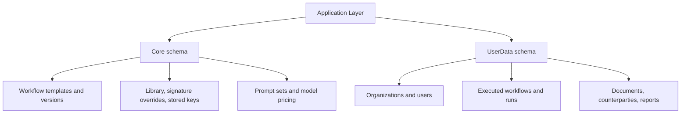

# Database Schema Overview

The platform keeps its data in two EF Core contexts. `CoreDbContext` maps the `Core` schema: workflow templates and deployment-wide configuration. `UserDataDbContext` maps the `UserData` schema: organizations, users and everything a run produces. The column-by-column references are [Core Database Schema](core-database.md) and [User Data Database Schema](user-data-database.md).

## Two databases



Each context reads its own connection string, `CoreDbConnection` and `UserDataDbConnection` (`DatabaseConfigurator`), so the two schemas can share one server or sit on two.

## What each schema holds

| Schema | Holds | Reference |
|--------|-------|-----------|
| `Core` | Workflow templates (`Workflows`, `Sections`, `Blocks`, `TextInputs`, `RagSettings`, `DocumentClasses`, `WorkflowVariable`, `WorkflowSignatureField`, `WorkflowRegressionField`), workflow types and their organization access, template versions, the shared-component Library, signature overrides, stored keys, document categories, model pricing, validation schemas and the prompt sets of the processing tools | [Core Database Schema](core-database.md) |
| `UserData` | Organizations, users and memberships (ASP.NET Identity and OpenIddict tables), executed workflow copies and their runs, documents and files, counterparties, the report tree, agent runs, validation, fund monitoring, token usage | [User Data Database Schema](user-data-database.md) |

The template entity classes are shared: the same `Workflow`, `Section` and `Block` classes hold an editable template in Core and an executed copy in UserData. A run copies the template into UserData and records the template version it ran against in `WorkflowExecutions.TemplateVersionId`. Ids that cross the two schemas, such as `WorkflowTypeId` or `TemplateVersionId`, are plain strings with no foreign key.

## Tenant scoping

Tenant scoping is enforced in the application layer. There is no EF Core tenant query filter and no database row-level security: most UserData tables carry `OrganizationId`, and handlers filter on it. Core holds no tenant data except per-organization rows such as stored keys, signature overrides and workflow type access. How the tenant is resolved and checked is on [User Data Database Schema: Tenant Isolation Implementation](user-data-database.md#tenant-isolation-implementation).

## Shared patterns

- **Soft delete.** Entities that implement `IAuditableEntity` (the `Entity<T>` base class) carry `CreatedAt`, `UpdatedAt`, `UpdatedByUserId`, `IsDeleted`, `DeletedAt` and `DeletedByUserId`. `ModelBuilderExtensions.ApplySoftDeleteFilter` gives each of them a global query filter on `IsDeleted == false`; it is the only global query filter in either context.
- **JSON columns.** Configuration and payload columns, such as `Blocks.Properties`, `Workflows.Configuration` and `WorkflowExecutions.Variables`, are `jsonb` on PostgreSQL and `nvarchar(max)` on SQL Server; the context picks the type from the provider name. Neither schema has a GIN or other JSON index.
- **Execution state.** `Workflows.ExecutionState`, `Blocks.ExecutionState` and `TextInputs.ExecutionState` exist only in UserData. Core block properties are written without their `executionState` field.

## Database providers

| Provider | Migrations project | JSON column type |
|----------|--------------------|------------------|
| PostgreSQL | `IniaAi.Migrations.PostgreSql` | `jsonb` |
| SQL Server | `IniaAi.Migrations.Mssql` | `nvarchar(max)` |

Each project has a `Core/` and a `UserData/` folder, one per context, and both providers receive every migration.

## Migrations

The application migrates both databases on every start, in every environment: `DatabaseConfigurator.InitializeDatabases` runs `DatabaseMigrationHelper.MigrateDatabase` for UserData and seeds it, then does the same for Core, whose seeding also runs the prompt seeds and the startup data migrations (`IStartupDataMigration`). With the environment variable `RESEED_DB=true`, it first drops and recreates both databases.

To author a migration, generate it against the provider project and the context, for example:

```bash
dotnet ef migrations add MigrationName --context UserDataDbContext \
  --project IniaAi.Migrations.PostgreSql
```

The repository's `create_and_apply_migration` scripts (`.sh`, `.zsh`, `.ps1`) wrap this for both providers.
