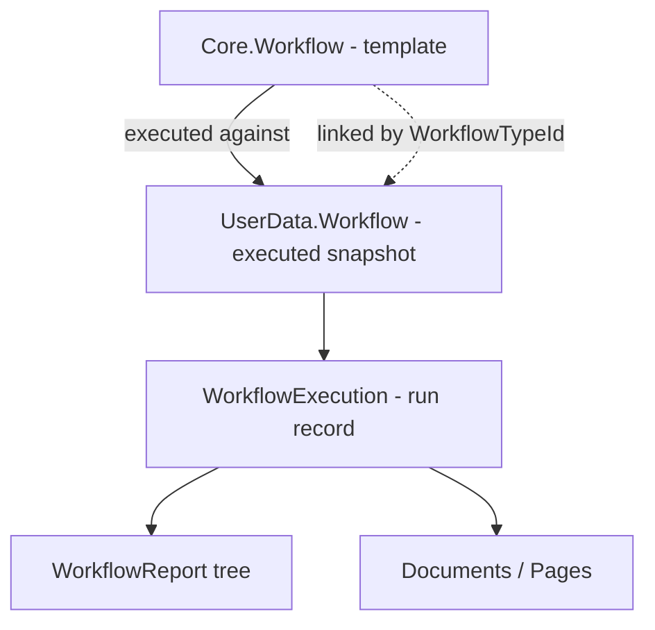

# User Data Database Schema

**On this page:** Schema: `UserData` · Two-Context Model (Templates vs. Executed Instances) · Comprehensive Entity Relationship Diagram · User Management & Organizations · Workflow System · Business Entities · Document Management · Block Execution System · Workflow Output (Report Tree) · Validation · Fund Monitoring (paid build) · Regression (dormant, paid build) · Tools and Templates · Graph Provenance · Token Usage · Self-serve · Framework Tables · Tenant Isolation Implementation · Performance Optimization · Soft Delete & Cleanup

The `UserData` schema holds **executed** workflow instances and the tenant-specific operational data they produce — documents, counterparties, report trees, embeddings, token usage, and audit history. It uses the **same entity classes** as the Core schema but persists a different shape of them: each `Workflow` row here is an immutable snapshot of an execution, not an editable template.

## Schema: `UserData`

Mapped through `UserDataDbContext` (schema `UserData`). The context registers a **single global query filter** — soft delete (`IsDeleted == false`), applied by `ModelBuilderExtensions.ApplySoftDeleteFilter` in `OnModelCreating`. There is **no automatic tenant query filter and no database row-level security** (see [Tenant Isolation Implementation](#tenant-isolation-implementation) below). Tenant scoping is enforced at the application layer.

## Two-Context Model (Templates vs. Executed Instances)

The platform uses two EF Core contexts that share the `Workflow`/`Section`/`Block` entity classes:

- **`CoreDbContext` (schema `Core`)** — workflow **templates** that prompt engineers author and edit.
- **`UserDataDbContext` (schema `UserData`)** — **executed** copies. Each row records "what the template looked like when we ran it, plus how the execution mutated it (variable values, branch decisions, expanded sections)."

A UserData `Workflow` is therefore append-only history, not a template. The link back to the originating template is the cross-instance string identity **`Workflow.WorkflowTypeId`** (carried in both contexts) — there is no `TemplateId` foreign key. The two contexts may live in one physical database (two schemas) or in two physical databases; the topology is a connection-string deployment choice.

## Comprehensive Entity Relationship Diagram

```mermaid
erDiagram
    %% Tenancy
    Organization ||--o{ User : employs
    Organization ||--o{ UserOrganization : maps
    User ||--o{ UserOrganization : belongs

    %% Workflow System
    Organization ||--o{ Workflow : owns
    Organization ||--o{ WorkflowExecution : executes
    User ||--o{ WorkflowExecution : triggers
    Workflow ||--o{ Section : contains
    Section ||--o{ Block : contains
    Workflow ||--o{ WorkflowVariable : configures
    WorkflowExecution ||--o{ WorkflowExecutionLog : logs
    WorkflowExecution ||--o| WorkflowReport : produces
    WorkflowReport ||--o{ ReportSection : contains
    ReportSection ||--o{ ReportParagraph : contains
    ReportParagraph ||--o| Block : "derived from"
    WorkflowExecution ||--o{ WorkflowExecutionCounterparty : analyzes

    %% Block System
    Block ||--o{ TextInput : configures
    Block ||--o{ RagSettings : uses
    Block ||--o| BlockResponse : responds
    Block ||--o{ AgentRunTraceFile : evidences
    Block ||--o{ AgentRunOutput : attempts
    Block |o--o{ AgentRunSessionBundle : resumes
    AgentConversation |o--o{ AgentRunSessionBundle : resumes
    AgentConversation ||--o{ AgentConversationTurn : "holds"
    AgentConversation ||--o{ EditorAgentDraft : "snapshots"
    AgentConversation ||--o{ EditorAgentTurnReports : "reads reports"
    AgentConversation ||--o{ EditorAgentTurnFeedback : "works on feedback"
    AgentConversationTurn ||--o| EditorAgentProposal : proposes
    EditorAgentProposal ||--o{ EditorAgentChangeDecision : "decided by"
    WorkflowExecution }o--o{ VerificationCriterionRecord : "records (no FK)"

    %% Business Entities
    Organization ||--o{ Counterparty : manages
    CounterpartyType }o--o{ Counterparty : classifies

    %% Document Management
    Organization ||--o{ Document : stores
    Organization ||--o{ FileMetadata : stores
    Document ||--o| FileMetadata : "backed by"
    Document ||--o{ Page : contains
    Page ||--o| EmbeddingVector : embeds

    %% Validation
    ValidationCase ||--o{ ValidationRun : "compared against"
    ValidationSuite }o--o{ ValidationCase : "lists (no FK)"
    ValidationCase ||--o{ ValidationReferenceAuditLog : "audits (no FK)"

    %% Entity Definitions
    Organization {
        string Id PK
        string Name
        bool IsActive
        string ParallelApiKey
        string PerplexityApiKey
        string FmpApiKey
        int SignatureReviewThreshold
        decimal EditorAgentDailySpendBatchUsd
        DateTime CreatedAt
        bool IsDeleted
    }

    User {
        string Id PK "ASP.NET Identity"
        string Email "from IdentityUser"
        string UserName "from IdentityUser"
        string OrganizationId FK
        string FirstName
        string LastName
        string MiddleName
        bool IsSystem
    }

    UserOrganization {
        string UserId PK, FK
        string OrganizationId PK, FK
        bool IsDefault
        bool IsActive
        DateTime JoinedAt
        DateTime LeftAt
    }

    Workflow {
        string Id PK
        string WorkflowTypeId "cross-instance identity"
        string Name
        string Title
        string Description
        string OrganizationId FK
        string UserId FK
        jsonb Configuration "WorkflowConfiguration"
        string TextInputTemplate
        string ParameterizedConfig
        jsonb ExecutionState
        DateTime CreatedAt
        bool IsDeleted
    }

    WorkflowVariable {
        string Id PK
        string WorkflowId FK
        string ReplacementTag
        string DisplayName
        int Type
        bool IsRequired
        bool IsHidden
        bool IsConfidential
        string DefaultValue
        jsonb Options
    }

    WorkflowExecution {
        string Id PK
        string WorkflowId
        string WorkflowTypeId
        string OrganizationId
        string UserId
        string CounterpartyId FK
        string Title
        string AnalystName
        DateTime ReviewDate
        string JobId
        jsonb Variables
        bool IsBaseline
        int WorkflowState "enum"
        string IdempotencyKey
        DateTime StartedAt
        DateTime CompletedAt
    }

    WorkflowExecutionLog {
        string Id PK
        string WorkflowExecutionId FK
        string WorkflowId
        string BlockId
        string SectionName
        string BlockName
        string BlockType
        string ReplacementTag
        jsonb Inputs
        string Prompt
        string Output
        int Status "BlockExecutionStatus"
        string ModelUsed
        interval Duration
        DateTime CreatedAt
    }

    Section {
        string Id PK
        string WorkflowId FK
        string Name
        string Title
        int Order
        int GroupColor
        jsonb Properties
        jsonb ExecutionState
        DateTime CreatedAt
        bool IsDeleted
    }

    Block {
        string Id PK
        string SectionId FK
        string Name
        string Type
        int Order
        jsonb Properties
        jsonb ExecutionState
        DateTime CreatedAt
        bool IsDeleted
    }

    BlockResponse {
        string Id PK
        string BlockId FK
        text RawResponse
        DateTime CreatedAt
    }

    TextInput {
        string Id PK
        string BlockId FK
        string ReplacementTag
        string Value
        jsonb ExecutionState
    }

    RagSettings {
        string Id PK
        string BlockId FK
        int Type "RagTypes"
        string QueryTemplate
        jsonb ExecutionState
    }

    Counterparty {
        string Id PK
        string Name
        string OrganizationId FK
        string ParentId FK
        string NameVariants
        string Email
        string PhoneNumber
        string Website
        string Address
        text LastFinancialAnalysisResult
        jsonb Properties "polymorphic"
        DateTime CreatedAt
        bool IsDeleted
    }

    CounterpartyCounterpartyType {
        string CounterpartiesId PK, FK
        string CounterpartyTypesId PK, FK
    }

    CounterpartyType {
        string Id PK
        string Name
        string Description
    }

    WorkflowExecutionCounterparty {
        string WorkflowExecutionId PK, FK
        string CounterpartyId PK, FK
    }

    Document {
        string Id PK
        string Name
        string OrganizationId FK
        string FileMetadataId FK
        int MediaType "enum"
        string Description
        string WorkflowTypeId
        string DocumentCategoryId FK
        string Class
        string OverviewPromptHash
        string Topics
        DateTime CreatedAt
        bool IsDeleted
    }

    FileMetadata {
        string Id PK
        string OrganizationId FK
        string DocumentId FK
        string Name
        string Extension
        long SizeBytes
        int StorageProvider "enum"
        string ExternalStoragePath
        DateTime CreatedAt
        bool IsDeleted
    }

    Page {
        string Id PK
        string DocumentId FK
        string EmbeddingVectorId FK
        int PageNumber
        int FilePageNumber
        text RawText
        text Text
        text Overview
        int Location "enum"
        int Status "enum"
    }

    EmbeddingVector {
        string Id PK
        string Model
        vector Vector "double[]"
    }

    WorkflowReport {
        string Id PK
        string WorkflowExecutionId FK
        string CounterpartyId FK
        string OrganizationId FK
        string WorkflowTypeId
        string JobId
        int WorkflowState
        string Title
        string AnalystName
        DateTime ReviewDate
    }

    ReportSection {
        string Id PK
        string WorkflowReportId FK
        int Order
        string Title
        jsonb Layout
        bool ExcludeFromWordExport
    }

    ReportParagraph {
        string Id PK
        string SectionId FK
        string BlockId FK
        int Kind
        int Order
        string Title
        text Content
        jsonb Citations
        jsonb CitedSourcesByBlock
        jsonb ChartPayload
        jsonb TablePayload
        DateTime CreatedAt
    }
```

> The `UserData` schema also holds entities not drawn above: ASP.NET Identity tables (`AspNetUsers`, `AspNetRoles`, `AspNetUserRoles`, …), OpenIddict tables (`Applications`, `Authorizations`, `Scopes`, `Tokens`), `UserTrustedDevices`, `Files`, `DocumentInfos`, `DocumentClasses`, `TokenUsages`/`TokenUsageComponents`/`TokenUsageDailyTotals`/`TokenUsageExecutionTotals`, `OrganizationModelSettings`, `OrganizationCleanupSettings`, `Json2XlsxTemplates`/`Json2XlsxTemplateVersions`, regression tables (`WorkflowRegressionRuns`, `WorkflowRegressionBlockResults`, `RegressionTestResults`), the hedge-fund / private-equity monitoring tables, and `graph_nodes`/`graph_edges`.

## User Management & Organizations

### Organizations
**Purpose**: Root tenant entities that provide the data-isolation boundary.

| Column | Type | Description |
|--------|------|-------------|
| `Id` | string (PK) | Unique organization identifier |
| `Name` | string | Organization name |
| `IsActive` | boolean | Organization status flag |
| `ParallelApiKey` | string | Replaced by the [stored key](../../features/user-management/stored-keys.md) of the same name. Startup moves a value into it and empties the column; the column goes in a later release (nullable) |
| `PerplexityApiKey` | string | Replaced the same way (nullable) |
| `FmpApiKey` | string | Replaced the same way (nullable) |
| `SignatureReviewThreshold` | integer | Signature review threshold (default 2) |
| `EditorAgentDailySpendBatchUsd` | decimal(18,2) (nullable) | The organization's daily batch of workflow agent spend in USD; null uses `PlatformSettings:EditorAgent:DailySpendBatchUsd` |
| `IsSelfServe` | boolean | The organization signed itself up and pays by subscription ([Self-serve](#self-serve)); false for every enterprise organization (default false) |
| `CreatedAt` | datetime | Creation timestamp (from `Entity<T>` base) |
| `IsDeleted` | boolean | Soft-delete flag (from `Entity<T>` base) |

### Users (ASP.NET Identity)
**Purpose**: User authentication, authorization, and profile management. `User` extends `IdentityUser`, so the standard Identity columns live on `AspNetUsers`: `UserName`, `NormalizedUserName`, `Email`, `NormalizedEmail` (each ≤256), `EmailConfirmed`, `PasswordHash`, `SecurityStamp`, `ConcurrencyStamp`, `PhoneNumber`, `PhoneNumberConfirmed`, `TwoFactorEnabled`, `LockoutEnabled`, `LockoutEnd` and `AccessFailedCount`. A disabled user has `LockoutEnd` at the maximum date ([Disabling users](../../features/user-management/index.md#disabling-and-enabling-users)).

| Column | Type | Description |
|--------|------|-------------|
| `Id` | string (PK) | Identity user id |
| `OrganizationId` | string (FK) | Primary organization |
| `FirstName` | string | User first name (nullable) |
| `LastName` | string | User last name (nullable) |
| `MiddleName` | string | User middle name (nullable) |
| `IsSystem` | boolean | Marks system/service accounts |

Roles are standard ASP.NET Identity roles (`AspNetRoles` + `AspNetUserRoles`) and are enforced with `[Authorize(Roles = …)]`. There is **no** `Role` column on the user or membership rows.

### UserOrganizations
**Purpose**: Many-to-many membership linking users to the organizations they can access.

| Column | Type | Description |
|--------|------|-------------|
| `UserId` | string (PK, FK) | User identifier |
| `OrganizationId` | string (PK, FK) | Organization identifier |
| `IsDefault` | boolean | Whether this is the user's default org |
| `IsActive` | boolean | Membership status |
| `JoinedAt` | datetime | Membership start |
| `LeftAt` | datetime | Membership end (nullable) |
| `AssignedByUserId` | string (≤450) | The staff user who made the assignment in the admin app's organization dialog; null for one made before it was recorded, or by sign-up, a seed or a CSV import (nullable) |

This table carries **no** `Role` or `Permissions` column — authorization is role-based via ASP.NET Identity, not a per-membership permission set.

### UserWorkflowTypeVisibilities
**Purpose**: The workflow types a user chose to see — a per-user [display filter](../../features/user-management/workflow-type-visibility.md) that narrows the type pickers and the reports listing, **never an access boundary**. A user with no rows sees every workflow type their organization can reach; rows can only narrow that set, never widen it.

| Column | Type | Description |
|--------|------|-------------|
| `UserId` | string (≤450) (PK, FK) | User identifier; cascade delete from `AspNetUsers` |
| `WorkflowTypeId` | string (≤100) (PK) | Chosen workflow type — a plain string reference to the Core `WorkflowType.Id` with **no** foreign key, because the reference crosses the Core/UserData context boundary |

A pure composite-key join: no surrogate `Id`, and no audit or soft-delete columns (the entity does not implement `IAuditableEntity`, which is what the global soft-delete filter keys on). There is **no** `OrganizationId` column — a user's selection spans every organization they belong to, and organization scoping comes from the read paths, not from this table.

### UserTrustedDevices
**Purpose**: Represents a device that has been trusted for 2FA bypass.

| Column | Type | Description |
|--------|------|-------------|
| `Id` | string (≤450) (PK) | Unique identifier for the trusted device record. |
| `DeviceFingerprint` | string (≤256) | A unique fingerprint identifying the device (browser fingerprint, device ID, etc.). |
| `DeviceName` | string (≤256) | Optional friendly name for the device (e.g., "Chrome on Windows"). (nullable) |
| `IpAddress` | string (≤45) | The IP address from which the device was trusted. (nullable) |
| `TrustedUntil` | datetime | The date and time until which this device is trusted. |
| `UserAgent` | string (≤512) | The User-Agent string of the device. (nullable) |
| `UserId` | string (≤450) | The ID of the user who owns this trusted device. |

Audit columns: `CreatedAt`.

## Workflow System

### Workflows (Executed Instances)
**Purpose**: Executed snapshots of a Core template. A UserData `Workflow` is immutable history, linked back to its template by `WorkflowTypeId`.

| Column | Type | Description |
|--------|------|-------------|
| `Id` | string (PK) | Unique workflow row identifier |
| `WorkflowTypeId` | string | Cross-instance identity (links to the Core template) |
| `Name` | string | Workflow name |
| `Title` | string | Display title |
| `Description` | string | Description (nullable) |
| `OrganizationId` | string (FK) | Owning organization (also a "who saved" stamp) |
| `UserId` | string (FK) | User associated with the row |
| `Configuration` | jsonb | Serialized `WorkflowConfiguration` (grid layout, settings) |
| `TextInputTemplate` | string | Workflow-level text-input template |
| `ParameterizedConfig` | string | Serialized parameterization config (nullable) |
| `ExpandedFromParameterizedKey` | string | Set on a workflow expanded from a parameterized variant: the originating variant key (nullable) |
| `Notes` | string | What the workflow is for and how it is meant to work, in plain words, saved with the workflow; the editor agent reads it, nothing reads it when the workflow runs (nullable) |
| `ExecutionState` | jsonb | Serialized `WorkflowExecutionState`: the run's workflow-level state. The entity marks the property `[NotMapped]`, but `UserDataDbContext` maps it to this column with a JSON value converter (nullable) |
| `CreatedAt` | datetime | Creation timestamp |

There is no `TemplateId`, `InstanceType`, or `ExecutionCount` column.

### WorkflowExecutions
**Purpose**: The run record for an executed workflow. Has a unique index on `(IdempotencyKey, OrganizationId)`.

| Column | Type | Description |
|--------|------|-------------|
| `Id` | string (PK) | Unique execution identifier |
| `WorkflowId` | string | Executed workflow row (nullable) |
| `WorkflowTypeId` | string | Cross-instance identity |
| `OrganizationId` | string | Owning organization |
| `UserId` | string | User who triggered the run |
| `CounterpartyId` | string (FK) | Analyzed counterparty (nullable) |
| `Title` | string | Run title |
| `AnalystName` | string | Analyst name (nullable) |
| `ReviewDate` | datetime | Review date (nullable) |
| `JobId` | string | Associated background job (nullable) |
| `Variables` | jsonb | `Dictionary<string, object>` of input variables |
| `IsBaseline` | boolean | Marks a regression baseline run |
| `WorkflowState` | integer | `WorkflowState` enum (persisted as int) |
| `IdempotencyKey` | string (≤64) | Dedup key for submission (nullable) |
| `StartedAt` | datetime | When the worker dequeued the run (nullable) |
| `CompletedAt` | datetime | When the run reached a terminal state (nullable) |
| `FailureKind` | string (≤64) | Why the run ended `Failed`, from `WorkflowExecutionFailureKinds` or a module's own kinds (the screening module's `ScreeningFailureKinds`) (nullable) |
| `FailureDetail` | string (≤2000) | Human-readable explanation naming the block and its error, truncated to the column limit at write time (nullable) |
| `WarningKind` | string (≤64) | Why a completed run still needs attention, from `WorkflowExecutionWarningKinds` (`UnverifiedRelease` — a verification group released its work unverified); written with the Draft transition, never after (nullable) |
| `WarningDetail` | string (≤2000) | Human-readable warning naming the verification block and its reason, truncated to the column limit at write time (nullable) |
| `ReplayUnmatchedJson` | text | Serialized `List<ReplayUnmatched>` written at the end of a replay run: captured outputs that matched no block, and freeze-eligible blocks with no capture — skipped and inconclusive on the dormant regression path, ran live on a frozen execution (nullable) |
| `FreezeSourceExecutionId` | string (≤450) | The finished (`Draft` or `Confirmed`) execution whose external-fetch outputs this execution replayed — the [freeze option](../api/workflow-executions.md#freezing-external-fetches); stamped at creation, marks a frozen execution (nullable) |
| `FreezeSourceCaseId` | string (≤450) | The validation case whose stored freeze captures this execution replayed, when the freeze source was a case rather than a same-instance execution; `FreezeSourceExecutionId` then names an execution of the deployment the case was imported from (nullable) |
| `FreezeReplayedCount` | integer | Freeze-eligible blocks served from the replay instead of a live fetch; written when the replay run ends (nullable) |
| `FreezeEligibleCount` | integer | Freeze-eligible blocks the replay run executed, loop clones counted individually — the coverage denominator (nullable) |
| `TemplateVersionId` | string (≤450) | The Core template version (`WorkflowVersion.Id`) the execution ran against, stamped at execution time; null when no version row existed. A loose cross-context id (nullable) |
| `TemplateContentHash` | string (≤64) | Content hash of the template the execution ran against, stamped at execution time; a baseline's staleness compares it with the live head (nullable) |
| `HostBootId` | string (≤450) | The process start ([HostBoots](#hostboots)) whose memory holds the run's job, so a run whose host stopped can be found; a loose id with no foreign key, indexed. Written when the row is created, by every process (nullable: rows from before it, and rows a test creates without a process start) |

`Duration` is a `[NotMapped]` computed `TimeSpan`. There is no `Status`, `Progress`, `ErrorMessage`, or `Results` column.

Both failure columns are written only by a `Failed` transition through `TryMarkTerminalIfActiveAsync`; a `Cancelled` or `Draft` transition leaves them null. The vocabulary is `CriticalBlockFailure` (a critical block's failure aborted the run), `ResultsLost` (block results could not be trusted), `LifetimeExceeded` (the janitor failed an execution stranded past its maximum lifetime), `HostLost` (the host-loss sweep failed a run whose process stopped heartbeating), `InputDocumentDeleted` (a document the run was sent was deleted before the run started, so the job stopped it before anything was read), `NoReadableDocuments` and `DocumentsNotRead` (the run content check, `IRunContentCheck`, stopped the run before its blocks because no document gave text to read, or because the model failed to read them; the open build's check passes every run; a run stopped by the self-serve token limit before its removal on 10 November 2026 holds `InputTooLarge`) — see [critical blocks abort the run](../../architecture/workflow-engine/parallel-execution.md#critical-blocks-abort-the-run) for how they are produced. Both columns are on the execution-list and report API contracts as `failureKind` and `failureDetail` ([Reports API](../api/reports.md)). A block failure also writes its reason as a `WorkflowExecutionLog` row, which is what the execution's Logs tab renders.

**`WorkflowState` enum values**: `Undefined`, `Running`, `Draft`, `Confirmed`, `Failed`, `ProcessingDocuments`, `Queued`, `Cancelled`. A run `IsActive()` while in `Running`, `ProcessingDocuments`, `Queued`, or `Undefined` — the creation default counts as active so a row born there can still be cancelled or failed.

### HostBoots
**Purpose**: One row per start of an application process, with when it was last seen. The job queue lives in process memory, so a run whose boot is no longer seen will never finish; `WorkflowExecutions.HostBootId` names the boot that holds each run. Written and heartbeated only where host-loss recovery is on; elsewhere the table stays empty. How the rows are written and read: [Background Jobs](../../architecture/background-jobs/index.md#operational-troubleshooting). Indexed on `LastSeenAt`.

| Column | Type | Description |
|--------|------|-------------|
| `Id` | string (PK) | Boot identifier |
| `Application` | string (≤100) | The process, such as the API |
| `Machine` | string (≤250) | The machine or container it ran on |
| `StartedAt` | datetime | When the process started |
| `LastSeenAt` | datetime | The last heartbeat |

### WorkflowExecutionLogs
**Purpose**: Per-block diagnostic record captured during a run — one row per executed block, not a generic log line.

| Column | Type | Description |
|--------|------|-------------|
| `Id` | string (PK) | Unique log entry identifier |
| `WorkflowExecutionId` | string (FK) | Parent execution |
| `WorkflowId` | string | Workflow row reference (nullable) |
| `BlockId` | string | Source block (nullable) |
| `SectionName` | string | Owning section name |
| `BlockName` | string | Block name |
| `BlockType` | string | Block type (e.g. `AiQuery`, `Merge`) |
| `ReplacementTag` | string | Block output replacement tag |
| `Inputs` | jsonb | `Dictionary<string,string?>` of resolved inputs |
| `Prompt` | string | Final prompt sent to the model |
| `TemplatePrompt` | string | Raw prompt before substitution |
| `Output` | string | Block output/response |
| `ConfidenceScore` | double | Output confidence (nullable) |
| `Sources` | text[] | Sources referenced by the output |
| `Status` | integer | `BlockExecutionStatus` (Completed/Failed/Skipped) |
| `Error` | string | Error message if the block failed |
| `RefusalCategory` | varchar(64) | Set when the model refused the block or page (nullable): the provider's `stop_details.category` such as `reasoning_extraction`, `unspecified` when the provider named none, or `written` for a refusal the model wrote as its answer. See [model refusals](../../architecture/ai-integration/providers.md#model-refusals) |
| `Duration` | interval | Block execution duration |
| `ModelUsed` | string | Model the block called: an Agent or Verification block's configured model, an AiQuery block's model override or its tier label (`Advanced Model`, `Simple Model`), and null for a block that calls no model. A block that ran but feeds no report gets the same row as one that does; only a block that never ran or was skipped gets a skip row with no model |
| `ShouldDisplayInLogs` | boolean | Whether to surface the entry in the UI |
| `CreatedAt` | datetime | Log entry timestamp |

Log rows optionally attach to a `ReportParagraph` via the shadow FK `ReportParagraphId` (`onDelete: SetNull`).

### DocumentClasses
**Purpose**: The document classes of an executed workflow: the copy of the template's `DocumentClass` rows that a run carries, so the run keeps the classes it ran with. The template rows are on [Core: DocumentClasses](core-database.md).

| Column | Type | Description |
|--------|------|-------------|
| `Id` | string (PK) | Primary key |
| `Description` | string |  |
| `DisplayName` | string (≤1000) |  |
| `DocumentCategoryId` | string (≤100) | (nullable) |
| `IsOutputDocument` | boolean |  |
| `Key` | string (≤450) |  |
| `LlmDescription` | string | What qualifies a document as this class, written for a model rather than a person: distinguishing features, near-miss classes, what the document is not. (nullable) |
| `MadeByDocumentClassKey` | string (≤450) | The output class of `MadeByWorkflowTypeId` that a file of this class is. (nullable) |
| `MadeByWorkflowTypeId` | string (≤100) | The workflow type whose output a file of this class is. (nullable) |
| `PageOverviews` | string | The prompts this class's pages are summarised with. Empty means the workflow's default prompts apply, and without those the pages get no overview. (nullable) |
| `Requirement` | integer | `Required`, `Suggested` or `Optional` |
| `ShouldBeSingular` | boolean |  |
| `WorkflowId` | string | The executed workflow |

Audit columns: `CreatedAt`, `DeletedAt`, `DeletedByUserId`, `IsDeleted`, `UpdatedAt`, `UpdatedByUserId`.

### WorkflowVariable
**Purpose**: The variables of an executed workflow: the copy of the template's `WorkflowVariable` rows that a run carries.

| Column | Type | Description |
|--------|------|-------------|
| `Id` | string (PK) | Primary key |
| `DefaultValue` | string | (nullable) |
| `Description` | string |  |
| `DisplayName` | string (≤1000) |  |
| `IsConfidential` | boolean |  |
| `IsHidden` | boolean |  |
| `IsRequired` | boolean |  |
| `Options` | jsonb | Dropdown options, key to label |
| `ReplacementTag` | string (≤450) |  |
| `Type` | integer | The variable type, as on the template |
| `WorkflowId` | string | (nullable) |

### WorkflowSignatureField
**Purpose**: A workflow-level signature field definition. Blocks reference a definition by carrying the `{Name}` token in their prompt templates — the token is the binding, nothing is stored on the block — so the definition (and every client override keyed by `Name`) survives block restructuring, and one field can be shared by any number of blocks.

| Column | Type | Description |
|--------|------|-------------|
| `Id` | string (PK) | Primary key |
| `DefaultValue` | string | The staff-authored value injected when no client override row exists. |
| `Description` | string |  |
| `DisplayName` | string (≤450) |  |
| `Name` | string (≤200) | The placeholder name; the identity that override rows are keyed by and the token blocks reference as `{Name}`. Unique per workflow (case-insensitive), enforced by save validation. Max length matches `SignatureFieldOverride.PlaceholderName` (200). |
| `WorkflowId` | string | The executed workflow |

### WorkflowRegressionField
**Purpose**: A workflow-level regression metric definition (name, type, tolerance). The block that produces the field carries only a binding (source + locator) in `RegressionSchema`, keyed by `Name`, so the metric survives block restructuring: deleting a block leaves the definition in place to be re-bound instead of losing it.

| Column | Type | Description |
|--------|------|-------------|
| `Id` | string (PK) | Primary key |
| `Name` | string (≤450) | The field name; the join key between this definition and a block binding. Unique per workflow (case-insensitive), enforced by save validation. |
| `Tolerance` | decimal(28,8) | Percentage tolerance for numeric comparisons (e.g. 5 for ±5%). Ignored for text fields. |
| `Type` | string (≤50) | One of `RegressionFieldTypes` ("numeric" or "text"). |
| `WorkflowId` | string | The executed workflow |

## Business Entities

### Counterparties
**Purpose**: Business entities and contacts managed by organizations.

| Column | Type | Description |
|--------|------|-------------|
| `Id` | string (PK) | Unique counterparty identifier |
| `Name` | string (≤250) | Counterparty name |
| `OrganizationId` | string (FK) | Owning organization |
| `ParentId` | string (FK) | Hierarchical parent (nullable, no-action delete) |
| `NameVariants` | string (≤500) | Alternative names, separated by `\|` (plain string, not JSON) |
| `Email` | string (≤100) | Contact email (nullable) |
| `PhoneNumber` | string (≤20) | Contact phone (nullable) |
| `Website` | string (≤1000) | Website (nullable) |
| `Address` | string (≤1000) | Address (plain string, not JSON) |
| `LastFinancialAnalysisResult` | text | Latest financial analysis (nullable) |
| `Properties` | jsonb (nullable) | Freeform key→value bag (`Dictionary<string, string>`); null column for a null or empty bag |
| `CreatedAt` | datetime | Creation timestamp |

There is no `ContactPerson` column.

`Properties` is a **freeform key→value bag** (`Dictionary<string, string>`, stored as `jsonb`). Keys
are coined by prompt engineers and emerge with use; values are arbitrary strings — prose, a markdown
table, a prompt snippet, or a JSON document. Workflows read a value through `{Counterparty.key}` or,
per loop iteration, `{Funds.key}` placeholders, traversing a JSON value by path or extracting an
XML-tagged fragment exactly as they would a block response — see
[Loop Processing](../../architecture/workflow-engine/loop-processing.md#counterparty-data-per-iteration). A
key absent on a fund falls back to the same key on its parent counterparty.

Keys are compared case-insensitively: the bag is normalized to an `OrdinalIgnoreCase` map on every
assignment, so reads are plain lookups and writes upsert in place. Original key casing is preserved
in the stored JSON.

The column is mapped with a `ValueComparer` that compares the serialized bag, so edits made *inside* a
loaded dictionary — by the editor or by a block's write-back — are detected by change tracking.
Without it EF compares by reference and in-place edits never reach the database.

### CounterpartyCounterpartyType (Join Table)
**Purpose**: Many-to-many between counterparties and their types.

| Column | Type | Description |
|--------|------|-------------|
| `CounterpartiesId` | string (PK, FK) | Counterparty identifier |
| `CounterpartyTypesId` | string (PK, FK) | Counterparty type identifier |

### CounterpartyTypes
**Purpose**: Business-entity classification, **shared across all organizations** (not org-scoped).

| Column | Type | Description |
|--------|------|-------------|
| `Id` | string (PK) | Unique type identifier |
| `Name` | string (≤250) | Type name |
| `Description` | string (≤1000) | Type description (nullable) |

**Defined counterparty types** (constants on `CounterpartyType`):
- `Corporation`
- `Hedge Fund`
- `Hedge Fund Manager`
- `Real Money Fund`
- `Real Money Fund Manager`
- `Private Equity Fund`
- `Private Equity Fund Manager`

### WorkflowExecutionCounterparties (Join Table)
**Purpose**: Many-to-many between executions and the counterparties they analyzed. A pure join — no payload columns.

| Column | Type | Description |
|--------|------|-------------|
| `WorkflowExecutionId` | string (PK, FK) | Execution identifier |
| `CounterpartyId` | string (PK, FK) | Counterparty identifier |

### CounterpartyDocument
**Purpose**: Implicit many-to-many join between `Counterparties` and `Documents` (EF Core shadow join table, composite key).

| Column | Type | Description |
|--------|------|-------------|
| `CounterpartiesId` | string (PK) | Counterparty |
| `DocumentsId` | string (PK) | Document |

### CounterpartyUser
**Purpose**: Implicit many-to-many join between `Counterparties` and `AspNetUsers` (EF Core shadow join table, composite key).

| Column | Type | Description |
|--------|------|-------------|
| `CounterpartiesId` | string (PK) | Counterparty |
| `UsersId` | string (PK) | User |

## Document Management

### Documents
**Purpose**: A processed document, backed by a `FileMetadata` blob.

| Column | Type | Description |
|--------|------|-------------|
| `Id` | string (PK) | Unique document identifier |
| `Name` | string (≤250) | Document name |
| `OrganizationId` | string (FK) | Owning organization |
| `FileMetadataId` | string (FK) | Backing file (`onDelete: Cascade`) |
| `MediaType` | integer | `MediaType` enum, set when the document is constructed from the type the intake gate detected in the bytes (`Document(FileMetadata, MediaType)`), never from the file name |
| `Description` | string (≤1000) | Description (nullable) |
| `WorkflowTypeId` | string | Associated workflow type (nullable) |
| `UserId` | string | Uploading user (nullable) |
| `DocumentCategoryId` | string (FK) | Document category (nullable) |
| `Class` | string | Document class (nullable) |
| `OverviewPromptHash` | string (≤64) | Hash of the overview prompt the pages were last summarised with (nullable); `none` when the last processing had no prompt and so wrote no overviews ([Overview generation](../../architecture/rag/overview-generation.md)) |
| `Topics` | string | Extracted topics (nullable) |
| `TableOfContents` | string | Extracted table of contents (nullable) |
| `Sources` | text[] | Source references |
| `WasPasswordProtected` | boolean | True when the stored copy came from a password-protected upload decrypted at ingest (default `false`) |
| `ProcessingRequestedAt` | datetime | When standalone processing was last requested; the concurrency token of the standalone path (nullable) |
| `ProcessedAt` | datetime | When the processing pipeline last completed a pass over the document, on any path (nullable) |
| `ProcessingError` | string (≤4000) | Why the last standalone processing attempt failed; cleared by the next request (nullable) |
| `HasMacros` | boolean | True when the intake gate found macros in the upload: a workbook that carries a VBA project. The file is still admitted; the mark keeps such files findable. Documents stored before 2026-09-22 read `false`, and so do workbooks the platform generates itself (Json2Xlsx outputs), because only intake sets it (default `false`) |
| `CountedPages` | integer | The pages the platform counts for the file, read from its bytes at upload with no model call ([Counted pages](../../architecture/document-processing/index.md#counted-pages)). For an email, the pages of its body. Null when the file could not be read, and on documents stored before the count existed, or emails stored before the email count existed, until they are uploaded again (nullable) |
| `CountedAttachmentPages` | integer | For an email, the counted pages of the files a run can extract from it. Null for any other file, when the email or one of those files could not be read, and on emails stored before the email count existed until they are uploaded again (nullable) |
| `EmailIdentifier` | string | For an email, the identifier ("{subject}_{sent date}") that the documents a run makes from it carry in `Sources`, read at upload. Null for any other file, when the email could not be read, and on emails stored before the email count existed until they are uploaded again (nullable) |
| `CreatedAt` | datetime | Upload timestamp |

There is no `FileName`, `ContentType`, `Size`, `Hash`, or `StoragePath` column — those concerns live on `FileMetadata`. The API derives `processingState` from the three processing stamps ([Documents API](../api/documents.md#standalone-processing)).

### DocumentInfos
**Purpose**: One document's membership in one job: the class and flags the run reads it under. A job's run input is its rows that no stage took out of the run, and every reader that treats a job's documents as run input filters with the one predicate `DocumentInfo.IsRunInputOf(jobId)`. A dropped row keeps its `JobId` for audit.

| Column | Type | Description |
|--------|------|-------------|
| `Id` | string (PK) | Unique row identifier |
| `DocumentId` | string (FK) | The document (indexed) |
| `JobId` | string | The job the document belongs to (indexed, nullable) |
| `DocumentClass` | string | The class the run reads the document under; stamped by the caller, the mouth, or, in the full edition, the screening stage |
| `ShouldUseOcr` | boolean | Whether the document is transcribed by OCR |
| `ShouldBeDisplayedInOutput` | boolean | Whether the document is listed in the output (default `true`) |
| `ExcludedAt` | datetime | When a stage that runs before document processing took the document out of the run; `null` while it is run input |
| `ExclusionReason` | string (≤64) | The stable code the excluding stage gave, today a `ScreeningReasonCodes` value (`Unreadable`, `NotExpectedDocument`, `NotNeeded`); `null` while the document is run input |
| `CreatedAt` | datetime | Creation timestamp |

The readers that filter by it: the report poll (`GetWorkflowExecutionQueryHandler`, which lists the dropped rows apart as `excludedDocuments`), the documents query (`PaginatedResponseDocumentsQueryHandler`), the Blazor documents list (`DocumentRepository.GetRunInputByJobIdAsync`), the re-run recipe of validation and of a stored-baseline regression re-run (`ValidationExecutionInputDocuments`), and the graph query's uploaded-class filter (`GraphQueryService`). A reader that needs every row on purpose reads the job's rows unfiltered: email intake, replay inheritance, the purge and the regression delete.

The exclusion columns are platform vocabulary, not screening fields, and stay when the screening module is removed.

### DocumentUnlockAuditLogs
**Purpose**: Append-only record of a password-protected document being decrypted at ingest — one row per unlock, written in the same transaction as the document. Deliberately carries **no foreign key** so the trail survives document deletion; the password itself is never stored. See [the unlock gate](../../architecture/document-processing/index.md#password-protected-files-the-unlock-gate).

| Column | Type | Description |
|--------|------|-------------|
| `Id` | string (PK) | Unique audit entry identifier |
| `OrganizationId` | string (≤450) | Owning organization (indexed with `CreatedAt`) |
| `DocumentId` | string (≤450) | Id of the unlocked document (no FK) |
| `DocumentName` | string (≤250) | Document name at unlock time |
| `ActorUserId` | string (≤450) | Uploading user (nullable — `null` for non-interactive email intake) |
| `ActorUserEmail` | string (≤256) | Actor email snapshotted at write time, surviving user renames/deletions (nullable) |
| `PasswordSupplied` | boolean | True when the uploader typed a password; false for owner-only PDFs stripped silently |
| `ContainedSignature` | boolean | True when the decrypted PDF contained a digital signature (invalidated by the strip) |
| `CreatedAt` | datetime | Unlock timestamp |

### ScreeningRecords
**Purpose**: The full edition's record of each intake screening decision. The open build creates the table and leaves it empty.

### ScreeningBacktests
**Purpose**: One screening backtest of the full edition. The open build creates the table and leaves it empty.

### ScreeningBacktestDocuments
**Purpose**: One input document of a screening backtest of the full edition. The open build creates the table and leaves it empty.

### ScreeningBacktestRuns
**Purpose**: One past run of a screening backtest of the full edition. The open build creates the table and leaves it empty.

### FileMetadata
**Purpose**: Stored-file metadata: name, size and where the bytes are stored.

| Column | Type | Description |
|--------|------|-------------|
| `Id` | string (PK) | Unique file metadata identifier |
| `OrganizationId` | string (FK) | Owning organization |
| `DocumentId` | string (FK) | Owning document (nullable) |
| `Name` | string | File name |
| `Extension` | string | File extension |
| `SizeBytes` | long | File size in bytes |
| `StorageProvider` | integer | `StorageProvider` enum (default `Database`) |
| `ExternalStoragePath` | string | The storage path the provider returned: an object key on S3 or MinIO, the `Files` row id on `Database` (nullable) |

`ContentType` is derived from `Extension` (not a stored column). `FileMetadata` holds no bytes: the `Database` provider keeps them in [`Files`](#files), S3 and MinIO in their buckets.

### Files
**Purpose**: The bytes of a file kept in the database: the `Database` storage provider writes here. `FileMetadata.ExternalStoragePath` names the row for such a file; an S3 or MinIO file has no row here.

| Column | Type | Description |
|--------|------|-------------|
| `Id` | string (PK) | Primary key |
| `Bytes` | bytea | The file content |
| `DocumentId` | string | The document the file belongs to (nullable) |
| `Extension` | string (≤10) | (nullable) |
| `Name` | string (≤450) | (nullable) |
| `OrganizationId` | string | (nullable) |
| `SizeBytes` | bigint | (nullable) |

Audit columns: `CreatedAt`, `DeletedAt`, `DeletedByUserId`, `IsDeleted`, `UpdatedAt`, `UpdatedByUserId`.

### Pages
**Purpose**: A page extracted from a document.

| Column | Type | Description |
|--------|------|-------------|
| `Id` | string (PK) | Unique page identifier |
| `DocumentId` | string (FK) | Parent document |
| `EmbeddingVectorId` | string (FK) | Page-level embedding (nullable) |
| `PageNumber` | integer | Logical page number |
| `FilePageNumber` | integer | Physical page number in the file |
| `RawText` | text | Raw extracted text |
| `Text` | text | Cleaned text |
| `Overview` | text | AI-generated page overview (nullable) |
| `SectionTitles` | string | Detected section titles (nullable) |
| `SourceUrl` | string | Source URL (nullable) |
| `Location` | integer | `PageLocation` enum (default `FullPage`) |
| `Status` | integer | `PageStatus` enum |
| `RefusalCategory` | varchar(64) | Set when the model refused to transcribe the page (nullable): the refusal category or `written`. Such a page has `OCRNeedsReview` and no text. See [OCR per-page outcomes](../../architecture/ocr/index.md#per-page-outcomes) |

### EmbeddingVectors
**Purpose**: Vector embeddings for semantic search. Embeddings are produced by **Cohere** (the platform's embedding provider); chat models are Anthropic / AWS Bedrock / Azure AI Foundry.

| Column | Type | Description |
|--------|------|-------------|
| `Id` | string (PK) | Unique embedding identifier |
| `Model` | string | Embedding model used |
| `Vector` | double[] | Embedding vector |

Note the FK direction: `Page` carries an `EmbeddingVectorId` pointing at `EmbeddingVectors`, rather than the embedding referencing the page. There is no `Chunks` table: the `RemoveChunks` migration dropped it, and no code had ever written a row.

## Block Execution System

### Sections (User Instances)
**Purpose**: Grouping of blocks within a workflow. Each section is owned by exactly one `Workflow` and owns an ordered collection of `Block` rows. A separator is a `Section` with no blocks, expressed through `SectionProperties.IsSeparator` (persisted inside `Properties`).

| Column | Type | Description |
|--------|------|-------------|
| `Id` | string (PK) | Unique section identifier |
| `WorkflowId` | string (FK) | Parent workflow instance |
| `Name` | string | Section name |
| `Title` | string | Display title |
| `Order` | integer | Sibling ordering within the workflow |
| `GroupColor` | integer | Section grouping color (`GroupColor` enum, nullable) |
| `Properties` | jsonb | Serialized `SectionProperties` (carries `IsSeparator` and `ExcludeFromWordExport`) |
| `StableSectionId` | string (nullable) | Stable identity carried over from the template section (suffixed per variant on parameterized expansion) |
| `SharedComponentId` / `SharedComponentLinkState` / `SharedComponentVersionHash` / `SharedComponentBindings` | string / integer / string(64) / jsonb (all nullable) | Shared-component link record copied verbatim from the template — records what was linked at execution time. Not indexed here; the registry itself is Core-only |
| `SharedComponentSlotStates` | jsonb (nullable) | Per-entry override map (slot tag → `Hidden`/`BrokenOut`) copied verbatim from the template section |
| `Description` | string | Section description (nullable) |
| `Configuration` | jsonb | Serialized section configuration (nullable) |
| `TextInputTemplate` | string | Section-level text-input template (nullable) |
| `ParameterizedConfig` | string | Serialized parameterization config (nullable) |
| `ExpandedFromParameterizedKey` | string | Set on a section expanded from a parameterized variant: the originating variant key (nullable) |
| `ExecutionState` | jsonb | Runtime execution state |
| `CreatedAt` | datetime | Section creation timestamp |

### Blocks (User Instances)
**Purpose**: Tenant-specific block instances with execution state.

| Column | Type | Description |
|--------|------|-------------|
| `Id` | string (PK) | Unique block instance identifier |
| `SectionId` | string (FK) | Parent section (nullable by design — transient/orphan blocks are valid) |
| `Name` | string | Block instance name |
| `Type` | string | Block execution strategy |
| `Order` | integer | Execution sequence within the section |
| `Properties` | jsonb | Block configuration |
| `StableBlockId` | string (nullable) | Stable identity carried over from the template block (suffixed on loop/parameterized expansion). Pairs baseline and rerun blocks in regression testing |
| `ReplacementTag` | string (≤100) | The block's output tag |
| `Description` | string | Block description (nullable) |
| `OutputTitleTemplate` | string (≤450) | Template of the output title, with placeholders (nullable) |
| `BlockResponseId` | string | The block's `BlockResponses` row (nullable) |
| `SupportedDocumentClasses` | text[] | Document classes the block reads |
| `IsOutputSource` | boolean | Whether the block's output feeds the report |
| `DataOutputName` | string (≤100) | The name the block's JSON is sent under as a data output, beside the report; null when the block is not one ([Get Report Data Outputs](../api/reports.md#get-report-data-outputs)) |
| `RunsAlone` | boolean | Whether the scheduler runs the block in a layer of its own, overlapping no other block (for side effects that must not overlap) |
| `ShouldDisplayInLogs` | boolean | Whether the block's log row shows in the UI |
| `ShouldUpdateCounterpartyWithResult` / `CounterpartyResultType` / `UpdateCounterpartyPropertyKey` | boolean / integer (nullable) / string (nullable) | The *Save Output for Counterparty* write-back: whether it is on, what it writes, and the property key a *Property* write-back uses ([Counterparties → Properties](../api/counterparties.md#properties)) |
| `RegressionSchema` | string | Regression field bindings: which workflow-level regression fields the block produces and how to locate each value in its output (nullable) |
| `SharedComponentId` / `SharedComponentLinkState` / `SharedComponentVersionHash` / `SharedComponentBindings` | string / integer / string(64) / jsonb (all nullable) | Shared-component link record copied verbatim from the template — records what was linked at execution time. Not indexed here; the registry itself is Core-only |
| `ExecutionState` | jsonb | Runtime execution state |
| `CreatedAt` | datetime | Block creation timestamp |

### BlockResponses
**Purpose**: Block execution result. One response per block.

| Column | Type | Description |
|--------|------|-------------|
| `Id` | string (PK) | Unique response identifier |
| `BlockId` | string (FK) | Source block instance |
| `RawResponse` | text | Complete model/output response |
| `JsonResponse` / `MarkdownResponse` / `HtmlResponse` | text | The response in the shape the block produced (nullable) |
| `BinaryResponse` | bytea | A binary output, such as a generated file (nullable) |
| `MediaType` | integer | `MediaType` enum of the response |
| `DebugInfo` | text | Diagnostic detail the block recorded (nullable) |
| `RegressionFacts` | text | Facts extracted for the dormant regression comparison (nullable) |
| `CreatedAt` | datetime | Response timestamp |

### BlockCitationTraces
**Purpose**: The citation trace of one executed block: the citation facts the block carried when it finished, how each came to be (cited by the block itself, split out of one of its cited passages, inherited from an earlier block, or cited to the input block that produced it), and every figure or source a citation step turned down, each with a fixed reason. Written by every run, for every block that runs the citation steps, and rewritten when the block's report paragraph adds its own decisions (each citation's source settling, its marker, the occurrences skipped, the citations dropped). Exists so a figure that reaches the report unmarked or wrongly linked can be explained after the run ([Citation traces](../../architecture/citations/index.md#citation-traces)). One row per block (unique on `BlockId`). Not soft-deletable — rows die with their block via `ON DELETE CASCADE`.

| Column | Type | Description |
|--------|------|-------------|
| `Id` | string (PK) | Unique trace identifier |
| `OrganizationId` | string | Direct tenant anchor, stamped by the run |
| `BlockId` | string (FK, unique) | Executed block the trace belongs to. Cascade-deletes with the block |
| `Content` | text | The trace as JSON (`CitationTraceContent`, version 1): `facts`, `sources`, `rejections`, and `report` once the paragraph is built. A fact inherited from an earlier block names that block's fact (`origin`) instead of repeating its sources, and a page source names its page id and the span its excerpt covers (`start`, `length`) instead of copying the text |
| `RecordedAt` | datetime | When the trace was last written |

### AgentRunTraceFiles
**Purpose**: One collected file of an agent run's trace pack — the evidence record of what the agent did, persisted verbatim by the platform when the run settles ([Agent block](../../guides/blocks/block-reference.md#agent)). The evidence record of an agent *run*, not of a block: `BlockId` is nullable so platform machinery running agents outside any workflow can persist traces too; the Agent block stamps its organization and block id to anchor rows beside its `BlockResponse`. Every consumer stamps `OrganizationId` directly — org scoping never rides the nullable block chain, so block-less rows stay tenant-queryable (the `TokenUsages` precedent). Deliberately not soft-deletable — rows die with their block through a DB-level `ON DELETE CASCADE` in the purge path, the same retention as `AgentRunOutputs` (see [Soft-Delete Cleanup](../../operations/soft-delete-cleanup.md)).

| Column | Type | Description |
|--------|------|-------------|
| `Id` | string (PK) | Unique trace-file identifier |
| `OrganizationId` | string | Direct tenant anchor, stamped by the consumer — never derived through the nullable block chain |
| `BlockId` | string (FK, nullable, indexed) | Executed Agent block the run belonged to; null for non-workflow agent runs. Cascade-deletes with the block |
| `RunExecutionId` | string (indexed) | The run's execution id on the runtime (`{workflowExecutionId}_{blockId}_w_r{round}_{pass}` for Agent blocks; the round is the verification leg, the pass a machinery retry) |
| `Attempt` | integer | Run attempt the pack was collected from |
| `Path` | string | Manifest path inside the pack (`trace/trace.ndjson`, `trace/sub/agent-*.jsonl`) |
| `Sha256` | string(64) | Content hash, verified against the runtime's manifest at collection time |
| `SizeBytes` | bigint | Content length in bytes |
| `Content` | bytea | The raw file bytes, verbatim — NDJSON fidelity is the contract; parsing is a consumer concern |
| `CollectedAt` | datetime | When the platform collected the file off the runtime |

### AgentRunOutputs
**Purpose**: The durable output of one settled agent-family leg — one row per block and verification round, so a redo leg appends its own row instead of overwriting the attempt before it. The settled `BlockResponse` is written from the recorded row at release; these rows are the history a later best-attempt selection can choose among. The output is stored as the leg produced it (before annotation processing strips inline markup from the response), so an attempt's annotations survive with its text. An agent leg's citations are the exception: they resolve against staged document pages at run time and never live in the text, so the row also stores them in `CitationFactsJson` for a best-attempt restore to re-apply. Unlike `AgentRunTraceFiles`, `BlockId` is required — an attempt output is meaningful only as a workflow block's candidate deliverable. Append-only across rounds; within a round, a crash-replayed re-execution updates the round's row in place (unique on `BlockId` + `Round`). Not soft-deletable — rows die with their block via `ON DELETE CASCADE`.

| Column | Type | Description |
|--------|------|-------------|
| `Id` | string (PK) | Unique attempt-output identifier |
| `OrganizationId` | string | Direct tenant anchor, stamped by the writer |
| `BlockId` | string (FK, required) | Executed agent-family block the leg ran for. Cascade-deletes with the block. Unique with `Round` |
| `Round` | integer | The verification leg the output settled under — the same axis the run ledger and run identity key by |
| `RunExecutionId` | string (indexed) | Run id of the pass that produced the output, joining the row to its ledger entry and trace files |
| `Output` | text | The leg's raw output, as produced |
| `CitationFactsJson` | text (nullable) | The agent citations this leg resolved, serialized so a best-attempt restore re-applies them. These resolve against staged document pages at run time and never live in `Output`, so a restore rebuilding annotations from text alone would drop them. Null when the leg resolved no citations |
| `RecordedAt` | datetime | When the attempt's output was recorded |

### AgentRunSessionBundles
**Purpose**: The pointer to one finished agent run's session bundle, held so a later leg can continue that session instead of starting over. The runtime keeps its own copy on a container tmpfs that any redeploy takes, so the platform fetches the bundle between trace collection and the run's acknowledgement, checks it against the digest the runtime declared, stores the bytes behind the [file-storage abstraction](../../operations/application-configuration.md#file-storage), and records this row — which means a row proves the bytes were in platform custody before the runtime released its copy. Written only for blocks inside a verification group (its members and the verifier's own legs): every other agent run leaves its bundle where it is and costs nothing. Custody fails open — a failed fetch or store logs, records no row, and never withholds the acknowledgement, because a lost bundle costs a redo leg its head start while a withheld acknowledgement holds runtime capacity for the whole retention window. Keyed on `BlockId` + `Round` like `AgentRunOutputs`, and for the same reason: a verification loop can restore a member to an earlier round's attempt, so the leg whose work currently stands is not always the latest one. Re-running a leg at the same round supersedes that round's row and deletes the superseded bytes. A row has exactly one owner: a block (a verification leg) or an [agent conversation](#agentconversations) (a turn, `Round` being the turn number, written only when the conversation's consumer allows resuming). The custodian refuses an anchor naming both or neither, and the check constraint `CK_AgentRunSessionBundles_ExactlyOneOwner` refuses such a row. Not soft-deletable — rows die with their block or conversation via `ON DELETE CASCADE`, and see [Soft-Delete Cleanup](../../operations/soft-delete-cleanup.md) for the block retention window; a conversation's bundles go with the conversation's retention, bytes before rows.

| Column | Type | Description |
|--------|------|-------------|
| `Id` | string (PK) | Unique custody-row identifier |
| `OrganizationId` | string | Direct tenant anchor, stamped by the writer |
| `BlockId` | string (FK, nullable) | Executed agent-family block the run belongs to. Cascade-deletes with the block. Unique with `Round`. Null for a conversation's bundle |
| `ConversationId` | string (FK, nullable) | The [agent conversation](#agentconversations) the run belongs to. Cascade-deletes with the conversation. Unique with `Round`. Null for a block's bundle |
| `Round` | integer | The verification leg that published the bundle, or the conversation turn number |
| `RunExecutionId` | string (indexed) | Run id whose session the bundle holds, joining the row to its ledger entry, output row and trace files |
| `Attempt` | integer | The run's attempt number as the runtime reported it, falling back to the pass number when the monitor reported none |
| `Segment` | integer | Which checkpoint of the run this is, in the runtime's numbering — the terminal bundle is `-1` |
| `Sha256` | string (64) | The digest the runtime declared, re-computed over the fetched bytes before the row was written |
| `SizeBytes` | long | Size of the stored bundle |
| `StorageProvider` | string (≤50) | Provider the bytes landed on (`Database`, `MinIO`, `S3`) |
| `StorageKey` | string (≤450) | Key the bytes are stored under, minted fresh per store |
| `VersionStamp` | string (≤1024, nullable) | The bundle's four-part version stamp as JSON — bundle format, sidecar build, SDK pin, and the model that governed the run. Null for a bundle written by a sidecar older than the stamp |
| `DroppedOutFileCount` | integer | How many of the leg's published `out/` files the trace collection could not keep; a non-zero count means a resume from this row would miss files, so the resume path starts from scratch and says why |
| `CreatedAt` | datetime (indexed) | When the platform took custody. The anchor the retention sweep measures from |

### AgentConversations
**Purpose**: A conversation one user holds with an agent on the agent runtime, owned by the shared agent-integration layer so any consumer can hold one ([Agent conversations](../../architecture/services/infrastructure/agent-runtime-integration.md#agent-conversations)). `Purpose` names the consumer (the workflow editor's agent is `edchat`) and prefixes every run id the conversation buys, so its runs' `AgentRunTraceFiles` rows are found by prefix. A conversation ends when its user starts a new one or when it has been idle past its purpose's retention window, and the next retention sweep hard-deletes it; its turns, drafts and session bundle rows go by cascade. Not soft-deletable.

| Column | Type | Description |
|--------|------|-------------|
| `Id` | string (PK) | Conversation identifier |
| `OrganizationId` | string | Direct tenant anchor |
| `UserId` | string | The user the conversation belongs to; another user's conversation reads as not found. Indexed with `Purpose` and `SubjectId` |
| `Purpose` | string (≤16) | The consumer's slug, in the run id alphabet |
| `SubjectId` | string (nullable) | What the conversation is about; for the editor agent, the workflow type id |
| `ModelId` | string (≤256) | The model the latest message ran on |
| `Effort` | string (≤32, nullable) | The reasoning effort the turns run at |
| `CreatedAt` | datetime | When the conversation started |
| `LastActivityAt` | datetime (indexed) | When a message was last sent or a turn last settled. Retention measures from here |
| `EndedAt` | datetime (nullable, indexed) | When the conversation stopped taking messages. Null while live. An optimistic concurrency token, so a message recorded against a conversation that ended meanwhile fails |

### AgentConversationTurns
**Purpose**: One message of an `AgentConversation` and the run that answered it — the turn's whole state, so a page that reloads mid-turn reattaches by reading it. A `Queued` turn with `DispatchedAt` null is **waiting**: an earlier turn of its conversation is in flight, and it starts on its own when that settles, also after a restart. Unique on `ConversationId` + `Number`, which also catches a second host racing the numbering. `Status` is an optimistic concurrency token, so two parties settling one turn cannot both win and a settled turn never moves back.

| Column | Type | Description |
|--------|------|-------------|
| `Id` | string (PK) | Turn identifier |
| `ConversationId` | string (FK) | Cascade-deletes with the conversation |
| `UserId` | string | Copied from the conversation so the per-user running cap reads one table. Indexed with `Status` |
| `Number` | integer | Position in the conversation, from one |
| `UserMessage` | text | The message as the user wrote it |
| `AnswerMarkdown` | text (nullable) | The agent's answer, set when the turn completes |
| `Status` | integer | `Queued` (0), `Running` (1), `Completed` (2), `Failed` (3), `Cancelled` (4). Indexed with `HostInstanceId` |
| `ModelId` | string (≤256) | The model the turn ran on |
| `RunExecutionId` | string (≤128, nullable) | Run id of the turn's latest pass; null until a run starts |
| `RunCount` | integer | Runs the turn bought, retries and continuation fallbacks included |
| `ResumedSession` | boolean | Whether the turn continued the previous turn's session |
| `CostUsd` | decimal(18,6) | The turn's billed spend |
| `Error` | string (≤2000, nullable) | Plain-language reason a turn did not complete |
| `ActivityJson` | text (nullable) | The settled activity digest, for the panel to replay |
| `JobId` | string (≤64, nullable) | The in-memory job running the turn on its host |
| `HostInstanceId` | string (≤128, nullable) | The host the turn was dispatched to; startup recovery abandons only its own host's turns |
| `ContextRef` | string (≤450, nullable) | The consumer's reference for what the turn read; for the editor agent, the `EditorAgentDrafts` row. No foreign key |
| `CreatedAt` | datetime | When the message was sent |
| `DispatchedAt` | datetime (nullable) | When the turn was handed to a host's job queue; null while it waits. The overdue sweep measures from here |
| `StartedAt` | datetime (nullable) | When its run started |
| `CompletedAt` | datetime (nullable) | When it settled |

### EditorAgentDrafts
**Purpose**: One distinct state of the workflow as the editor held it when its user sent a message to the editor agent: the export JSON with test-run outputs, compressed. A message over an unchanged workflow reuses the previous row; each turn points at the row it read through `AgentConversationTurns.ContextRef`. Private to the conversation's user, capped in size by `EditorAgent:MaxDraftMegabytes`, and deleted with the conversation. Unique on `ConversationId` + `Revision`.

| Column | Type | Description |
|--------|------|-------------|
| `Id` | string (PK) | Draft identifier |
| `ConversationId` | string (FK) | Cascade-deletes with the conversation |
| `WorkflowTypeId` | string | The workflow type the draft is of |
| `Revision` | integer | Counts the distinct workflow states the conversation has seen, from one |
| `ContentSha256` | string (64) | Digest of the export JSON, which decides reuse |
| `WorkflowJsonCompressed` | binary | The compressed export JSON |
| `CreatedAt` | datetime | When the state was first sent |

### EditorAgentProposals
**Purpose**: The changes the editor agent proposed in one turn, built against the `EditorAgentDrafts` row the turn read, and what it takes to undo the changes the user accepted. The proposal gate writes it when the agent leaves a changed workflow in its `out/` folder ([Agent conversations](../../architecture/services/infrastructure/agent-runtime-integration.md#agent-conversations)); a turn that changed nothing has no row. One row per turn (unique on `TurnId`), private to the conversation's user, and deleted with the turn. `Version` is a concurrency token renewed on every write, so two editor tabs deciding about one proposal at once cannot both record their decisions.

| Column | Type | Description |
|--------|------|-------------|
| `Id` | string (PK) | Proposal identifier |
| `TurnId` | string (FK, unique) | The `AgentConversationTurns` row that proposed it. Cascade-deletes with the turn |
| `ConversationId` | string (indexed) | Copied from the turn so a conversation's proposals read one table. No foreign key |
| `DraftId` | string | The `EditorAgentDrafts` row every change is paired against. No foreign key |
| `ProposedWorkflowSha256` | string (64) | Digest of the agent's `out/workflow.json`, which tells a new proposal from one a resumed session carried over |
| `ProposalJsonCompressed` | binary | The compressed `WorkflowProposal`: the change list, the agent's summary, the check errors and warnings, and why a change cannot be accepted |
| `UndoJsonCompressed` | binary (nullable) | The compressed undo record of the changes accepted and not yet undone; null when there is nothing to undo |
| `Version` | string (32) | Concurrency token, a new GUID on every write |
| `CreatedAt` | datetime | When the gate recorded the proposal |
| `UpdatedAt` | datetime (nullable) | When a decision last changed it |

### EditorAgentChangeDecisions
**Purpose**: What the user decided about one change of an `EditorAgentProposals` row. Unique on `ProposalId` + `ChangeId`. An undone change keeps its row with `Undone`. `SavedAt` is what the next save's version note counts from: an accepted change with no `SavedAt` is counted ("3 changes proposed by the editor agent") and stamped once a save writes a new version.

| Column | Type | Description |
|--------|------|-------------|
| `Id` | string (PK) | Decision identifier |
| `ProposalId` | string (FK) | Cascade-deletes with the proposal |
| `ChangeId` | string | The change's id inside the proposal |
| `Status` | integer | `Accepted` (0), `Rejected` (1), `Undone` (2) |
| `MintedStableId` | string (nullable) | The stable id an accepted added block or section received |
| `DecidedAt` | datetime | When the user decided |
| `SavedAt` | datetime (nullable) | When a save first carried this accepted change; null until then |

### EditorAgentSpendUnlocks
**Purpose**: More daily batches of workflow agent spend, unlocked by a user for their organization after the warning that today's batches were used ([Daily spend per organization](../../features/editor-agent.md#daily-spend-per-organization)). An organization's allowance for a day is its batch times one plus the sum of that day's `Batches`. Unique on `OrganizationId` + `Day` + `FromBatches`, so two users unlocking at the same moment add the batches once.

| Column | Type | Description |
|--------|------|-------------|
| `Id` | string (PK) | Unlock identifier |
| `OrganizationId` | string | The organization the batch is for |
| `UserId` | string | The user who pressed **Unlock and send** |
| `Day` | date | The UTC day the batches add to |
| `FromBatches` | integer | How many batches the day had when the user unlocked |
| `Batches` | integer | How many batches this unlock added: enough to bring the day one batch above its spend |
| `UnlockedAt` | datetime | When the user unlocked it |

### EditorAgentTurnReports
**Purpose**: The past reports one editor agent turn reads as evidence: those the user picked for the message, those the agent opened during the turn, and the digest of the agent's last report request. Every later turn of the conversation reads these reports again for the [report-text check](../../architecture/services/infrastructure/agent-runtime-integration.md#agent-conversations). Written before the turn row exists, so it hangs off the conversation, keyed by the turn's id, and is deleted with the conversation.

| Column | Type | Description |
|--------|------|-------------|
| `TurnId` | string (PK) | The turn's id. No foreign key, since the row is written first |
| `ConversationId` | string (FK, indexed) | Cascade-deletes with the conversation |
| `PickedExecutionIds` | string (≤2000) | The execution ids the user picked with **Use reports as examples**, comma separated |
| `FetchedExecutionIds` | string (≤2000) | The execution ids the agent opened during the turn through `out/open-reports.json`, comma separated |
| `OpenRequestSha256` | string (64, nullable) | Digest of the agent's last report request in the turn, which tells a new request from one a resumed session carried over |
| `CreatedAt` | datetime | When the row was written |

The reports a **Use feedback** message stages for its feedback count as opened in the turn and are listed in `FetchedExecutionIds`.

### EditorAgentTurnFeedback
**Purpose**: The [report feedback](../../features/report-feedback.md) one editor agent turn works on: the open items the user chose with **Use feedback**, and the items the agent then suggested dismissing. A save marks addressed the items the conversation was sent and the agent named for a saved change. The item ids are loose: an item purged since is skipped. Written before the turn row exists, so it hangs off the conversation, keyed by the turn's id, and is deleted with the conversation.

| Column | Type | Description |
|--------|------|-------------|
| `TurnId` | string (PK) | The turn's id. No foreign key, since the row is written first |
| `ConversationId` | string (FK, indexed) | Cascade-deletes with the conversation |
| `FeedbackItemIds` | string (≤2000) | The `ReportFeedbackItems` ids the user chose and sent with the message, newest first, comma separated; empty on a turn that only suggested dismissals |
| `OpenCount` | integer | How many items were open when the message was sent, chosen or not |
| `DismissSuggestionsJson` | string (nullable) | The agent's suggestions, `[{"FeedbackItemId": ..., "Reason": ...}]` |
| `DismissFileSha256` | string (64, nullable) | Digest of the file the suggestions came from, which tells a new file from one a resumed session carried over |
| `CreatedAt` | datetime | When the row was written |

### VerificationCriterionRecords
**Purpose**: The full edition's verification failure record, one row per criterion verdict per verification pass. The open build creates the table and leaves it empty.

### TextInputs (User Instances)
**Purpose**: Tenant-configured text inputs with resolved values.

| Column | Type | Description |
|--------|------|-------------|
| `Id` | string (PK) | Unique text input identifier |
| `BlockId` | string (FK) | Parent block instance |
| `ReplacementTag` | string | Parameter identifier |
| `Value` | string | Template or resolved value |
| `ExecutionState` | jsonb | Resolution state and result |

### RagSettings (User Instances)
**Purpose**: The RAG configuration of an executed block: the template's settings as the run used them. There is no `Strategy` or `Configuration` column.

| Column | Type | Description |
|--------|------|-------------|
| `Id` | string (PK) | Unique RAG settings identifier |
| `BlockId` | string (FK) | Associated block instance |
| `Type` | integer | The RAG strategy (`RagTypes` enum; default `TopNPagesPerFilterWithTwoNeighbors`) |
| `QueryTemplate` / `TopicsQuery` / `TableOfContentsInput` | string (nullable) | Query, topics query and table-of-contents input templates, with placeholders |
| `Keywords` / `SmartFilterExpressions` | text[] | Keyword and smart-filter templates, with placeholders |
| `StartIndexInput` / `EndIndexInput` / `ExactIndexesInput` / `NumberOfPagesInput` / `PageAdjustmentInput` / `ContextLimit` / `IterationLimit` | string (≤450) | Page-range, context and iteration inputs, as templates with placeholders |
| `ShouldSearchOverviews` / `ShouldIncludeNeighboringPages` / `ShouldFilterKeyWordsExclusively` | boolean | Search switches |
| `ExecutionState` | jsonb | Processing state: the inputs after placeholder replacement and the pages selected |

## Workflow Output (Report Tree)

Executed workflow output is stored as a fixed three-level report tree — `WorkflowReport` (root) → `ReportSection` → `ReportParagraph` (leaf) — that mirrors the report viewer. It replaced the old recursive, self-referencing `WorkflowOutputElement` table (one table whose rows were distinguished by an `OutputType` discriminator) with three dedicated tables. There is no standalone `Reports` table.

### WorkflowReports
**Purpose**: Root of the output tree — one row per execution.

| Column | Type | Description |
|--------|------|-------------|
| `Id` | string (PK) | Unique report identifier |
| `WorkflowExecutionId` | string (FK) | Source execution |
| `CounterpartyId` | string (FK) | Analyzed counterparty (nullable) |
| `OrganizationId` | string (FK) | Owning organization (report queries filter on it) |
| `WorkflowTypeId` | string | Cross-instance identity |
| `JobId` | string | Associated background job |
| `Title` | string | Report title |
| `AnalystName` | string | Analyst name |
| `ReviewDate` | datetime | Review date |
| `WorkflowId` | string | The executed workflow (nullable) |
| `UserId` | string | The user the run belongs to (nullable) |

A report has no state of its own: the run's state is the `WorkflowState` of its `WorkflowExecutions` row.

### ReportSections
**Purpose**: A report section under a `WorkflowReport`.

| Column | Type | Description |
|--------|------|-------------|
| `Id` | string (PK) | Unique section identifier |
| `WorkflowReportId` | string (FK) | Parent report (`onDelete: Cascade`) |
| `Order` | integer | Sibling ordering within the report |
| `Title` | string | Section title (nullable) |
| `Layout` | jsonb | Serialized `GridLayoutOutput` (single payload, not a collection) |
| `ExcludeFromWordExport` | boolean | Snapshot of the section's [Leave out of exports](../../guides/workflows/editor-guide.md#5-configure-sections) setting. `false` on rows written before the column existed |

There is no `Justification` or `Rating` column.

### ReportParagraphs
**Purpose**: A leaf node under a `ReportSection`. The leaf shape is carried by the `Kind` discriminator (`ReportParagraphKind`: Paragraph, DynamicChart, Divider, Table), not by separate types.

| Column | Type | Description |
|--------|------|-------------|
| `Id` | string (PK) | Unique paragraph identifier |
| `SectionId` | string (FK) | Parent `ReportSection` (`onDelete: Cascade`) |
| `BlockId` | string (FK) | Block this paragraph was derived from (nullable, `onDelete: SetNull`) |
| `ReplacementTag` | string | The source block's output tag (nullable) |
| `Kind` | integer | `ReportParagraphKind` enum (Paragraph=0, DynamicChart=1, Divider=2, Table=3) |
| `Order` | integer | Sibling ordering within the section |
| `Title` | string | Paragraph title |
| `Subtitle` | string | Paragraph subtitle |
| `Content` | text | Rendered paragraph content |
| `Confidence` | double | Confidence score |
| `Sources` | text[] / json | Source references (PG `text[]`; MSSQL JSON) |
| `Citations` | jsonb | Serialized `List<Citation>` |
| `CitedSourcesByBlock` | jsonb | Serialized `List<BlockCitedSources>`: for each block a block-only citation reaches, every page and link that block or its upstream blocks cited. Default `[]`, which is also what rows written before the column existed hold (MSSQL `nvarchar(max)`, default `N'[]'`) |
| `ChartPayload` | jsonb | Serialized `ChartOutput` (populated when `Kind = DynamicChart`) |
| `TablePayload` | jsonb | Serialized `TableOutput` (populated when `Kind = Table`) |
| `CreatedAt` | datetime | Output creation timestamp |

### ReportDataOutputs
**Purpose**: One block's JSON that a run returns beside its report ([Get Report Data Outputs](../api/reports.md#get-report-data-outputs)), written by the per-block writer when the block finishes. Never edited. Indexed on `(WorkflowReportId, Name)`.

| Column | Type | Description |
|--------|------|-------------|
| `Id` | string (PK) | Unique data output identifier |
| `WorkflowReportId` | string (FK) | Parent report (`onDelete: Cascade`) |
| `BlockId` | string (FK) | The block that produced the JSON (nullable); a re-entering write of the same block replaces its row |
| `Name` | string (≤100) | The block's `DataOutputName` at run time |
| `Json` | text | The JSON exactly as the block produced it. Plain text, not `jsonb`, which would reorder its keys |
| `Citations` | jsonb | Serialized `List<DataOutputCitation>`: a citation with the JSON Pointer `Path` of the value that holds the figure and the figure as written there (`Value`) |
| `CitedSourcesByBlock` | jsonb | Serialized `List<BlockCitedSources>`, as on `ReportParagraphs` |
| `CreatedAt` | datetime | Creation timestamp |

### ReportFeedbackItems
**Purpose**: A reader's feedback on a report, kept with the execution ([Report Feedback](../../features/report-feedback.md)). The item belongs to the report as a whole: there is no column for an output element, a block or a `StableBlockId`, and no foreign key, so an item survives report edits and paragraph deletions. The template version is read through the execution (`WorkflowExecutions.TemplateVersionId`), not repeated here. Indexed on `(OrganizationId, WorkflowExecutionId)` for the per-report read and on `(WorkflowTypeId, Status)` for the SuperAdmin cross-organization read. A delete removes the row outright, whatever its status; nothing references an item, so an `EditorAgentTurnFeedback` row that lists a deleted id keeps it and every read skips it.

| Column | Type | Description |
|--------|------|-------------|
| `Id` | string (PK) | Unique item identifier |
| `OrganizationId` | string | Owning organization; every per-report read filters on it |
| `WorkflowExecutionId` | string | The execution (report) the item belongs to (loose id, no FK) |
| `WorkflowTypeId` | string | The workflow type the execution ran (nullable) |
| `QuotedText` | string(4000) | The reader's text selection, plain text (nullable) |
| `Category` | integer | `ReportFeedbackCategory` enum (WrongFigure=0, MissingInformation=1, WrongClassification=2, WordingOrStyle=3, NotRelevant=4) |
| `Comment` | string(4000) | The reader's comment |
| `AuthorUserId` | string | Who recorded the item |
| `Status` | integer | `ReportFeedbackStatus` enum (Open=0, Addressed=1, Dismissed=2) |
| `DismissReason` | string(500) | Present only while `Status = Dismissed` |
| `StatusChangedByUserId` | string | The editor who last set `Status` (nullable) |
| `AddressedInVersionId` | string | The Core `WorkflowVersions.Id` whose save carried the editor agent's fix; set with `Status = Addressed` by that save, cleared by any later status change (nullable) |
| `CreatedAt`, `UpdatedAt`, `UpdatedByUserId` | audit | Common audit columns |

## Validation

Tables of the full edition's validation system: `ValidationCases`, `ValidationRuns`, `ValidationSuites`, `ValidationSchedules`, `ValidationThresholdSettings` and `ValidationReferenceAuditLogs`. The open build creates them and leaves them empty.

## Fund Monitoring (paid build)

Tables of the full edition's fund-monitoring module: `HedgeFundsMonitoringObservations`, `HedgeFundsControlResults`, `HedgeFundsMonitoringObservationAudits`, `PrivateEquityMonitoringObservations`, `PrivateEquityMonitoringObservationAudits` and `PrivateEquityMonitoringAllocations`. The open build keeps them in the schema with their migrations, but nothing writes them.

## Regression (dormant, paid build)

Tables of the full edition's dormant block-level regression comparison: `WorkflowBaselineRegistrations`, `WorkflowRegressionRuns`, `WorkflowRegressionBlockResults` and `RegressionTestResults`. The open build creates them and leaves them empty.

## Tools and Templates

### Json2XlsxTemplates
**Purpose**: A rendering template of the full edition's Json2Xlsx block. The open build creates the table and leaves it empty.

### Json2XlsxTemplateVersions
**Purpose**: One version of a Json2Xlsx rendering template. The open build creates the table and leaves it empty.

### ConversionTypes
**Purpose**: A conversion type of the full edition's Json2Xlsx block. The open build creates the table and leaves it empty.

### RefinementPresets
**Purpose**: A saved refinement instruction preset that users can reuse across sessions. Can be personal (user-specific) or shared (organization-wide).

| Column | Type | Description |
|--------|------|-------------|
| `Id` | string (PK) | Primary key |
| `Instruction` | string (≤2000) |  |
| `IsShared` | boolean | When true, the preset is visible to all users in the organization. When false, only the creating user can see and use it. |
| `Name` | string (≤100) |  |
| `OrganizationId` | string (≤450) |  |
| `UserId` | string (≤450) |  |

Audit columns: `CreatedAt`, `DeletedAt`, `DeletedByUserId`, `IsDeleted`, `UpdatedAt`, `UpdatedByUserId`.

## Graph Provenance

### graph_nodes
**Purpose**: One node of a run's Graph-RAG provenance graph — a block, an input variable or a document — keyed by run and key (`ReplacementTag` or block id); written for the [tracer agent](../../architecture/tracer-agent/index.md).

| Column | Type | Description |
|--------|------|-------------|
| `RunId` | string (≤450) (PK) | The execution |
| `Key` | string (≤450) (PK) | Node key within the run |
| `DocumentClass` | string (≤500) | (nullable) |
| `Kind` | string (≤50) | `block`, `input_variable`, `document` or `unknown` |
| `Label` | string (≤500) | (nullable) |
| `Order` | integer | (nullable) |
| `ReplacementTag` | string (≤450) | (nullable) |

### graph_edges
**Purpose**: One edge of a run's Graph-RAG provenance graph, between two `graph_nodes` of the same run; written for the [tracer agent](../../architecture/tracer-agent/index.md).

| Column | Type | Description |
|--------|------|-------------|
| `RunId` | string (≤450) (PK) | The execution |
| `SourceId` | string (≤450) (PK) | Source node key |
| `TargetId` | string (≤450) (PK) | Target node key |
| `Label` | string (≤500) | (nullable) |

## Token Usage

### TokenUsages
**Purpose**: One row per model call, embedding or rerank the platform pays for, with its priced parts in `TokenUsageComponents` (units and cost per component: input, output, cache reads, agent-run spend). It is the usage ledger. The usage reads (the dashboard `GET /token-usage/dashboard`, `GET /token-usage/me`, `GET /token-usage/workflow-type/{id}` and the validation estimate) do not sum it directly: they sum [`TokenUsageDailyTotals`](#tokenusagedailytotals) or [`TokenUsageExecutionTotals`](#tokenusageexecutiontotals) plus the ledger rows not yet in them. Every type below 20 counts as LLM tokens on the dashboard. Rows are kept for billing when the rows they point at are deleted ([soft-delete cleanup](../../operations/soft-delete-cleanup.md)).

`ITokenUsageService.RecordLlmUsageAsync` and `RecordEmbeddingUsageAsync` never fail the work that spent: a row that fails to save is logged and counted, and the API's `/readiness` reports the count on the "Token usage recording" check ([Health checks](../../architecture/multi-tenant/deployment.md#health-checks)).

| Column | Type | Description |
|--------|------|-------------|
| `Id` | string (≤36) (PK) | Row identifier |
| `OrganizationId` | string | Organization billed |
| `UserId` | string | User who started the work (nullable) |
| `WorkflowTypeId`, `WorkflowExecutionId`, `SectionId`, `BlockId` | string | Where in a run the spend happened (nullable). `WorkflowTypeId` holds up to 100 characters, as a workflow type id does (`WorkflowType.ID_MAX_LENGTH`) |
| `DocumentId`, `PageId` | string | The document or page the call read (nullable) |
| `UsageType` | integer | What triggered the spend, from `UsageType` below |
| `ExecutionContext` | integer | Where the call ran: `WorkflowExecution` (0), `SectionTest` (1), `BlockTest` (2), `DocumentUpload` (3), `ApiCall` (4), `SystemMonitoring` (5), `Validation` (6), `ScreeningBacktest` (7), `WorkflowEditorAgent` (8) |
| `BlockType` | integer | The block type, for block spend (nullable) |
| `Provider`, `Family`, `ModelId` | string | The model the call resolved to |
| `Duration` | interval | How long the call took (nullable) |
| `Description`, `Metadata` | string | Free text and JSON the recorder attached (nullable) |
| `ModelPricingId` | string | The price row the cost was computed from (nullable) |
| `IsInTotals` | boolean | Whether the usage-totals sweep has added the row to `TokenUsageDailyTotals` and `TokenUsageExecutionTotals`. The filtered index `IX_TokenUsages_NotInTotals` (`TokenUsageNotInTotalsIndex`) (`OrganizationId`, `CreatedAt`, including `IsDeleted`, `UsageType`, `WorkflowTypeId`, `UserId` and `WorkflowExecutionId`) holds only the rows it has not added, which every usage read sums beside the totals. It covers every column that read touches because SQL Server, given a filtered index it would have to look rows up from, scans the whole ledger instead |

| `UsageType` | Value | Spend |
|---|---|---|
| `LlmBlockExecution` | 0 | An AI query block in a run |
| `LlmOverviewGeneration` | 1 | Page overviews for RAG |
| `LlmOcrTextEnhancement` | 2 | Retired OCR pipeline; historical rows only |
| `LlmOcrMarkdownFormatting` | 3 | Retired OCR pipeline; historical rows only |
| `LlmClassification` | 4 | Document classification |
| `LlmReconciliation` | 5 | Reconciliation matching |
| `LlmRagFiltering` | 6 | RAG page selection |
| `LlmEntityClassification` | 8 | Named-entity classification (7 is an unused gap) |
| `LlmSpreadsheetAnalysis` | 9 | Spreadsheet layout analysis |
| `LlmGraphQuery` | 10 | Graph provenance queries |
| `LlmContentRefinement` | 11 | Content refinement |
| `LlmOcrTranscription` | 12 | OCR page transcription |
| `LlmOcrFidelityJudge` | 13 | OCR fidelity judge |
| `LlmAgentRun` | 14 | An agent run on the agent runtime |
| `LlmValidationExtraction` | 15 | Validation reference or candidate extraction |
| `LlmValidationJudge` | 16 | Validation prose judging |
| `LlmIntakeScreening` | 17 | The intake screening judge of the full edition, one row per judged document, on the Advanced tier |
| `LlmScreeningBacktest` | 18 | The judge in a screening backtest of the full edition, one row per judged file, on the organization of the operator who started the backtest, naming the document, with no execution and the execution context `ScreeningBacktest` |
| `LlmEditorAgentChat` | 19 | One message to the [editor agent](../../features/editor-agent.md): the spend of a conversation turn on the agent runtime, every round and retry included, under the execution context `WorkflowEditorAgent` and the open workflow's type, with no execution. Shown on the usage dashboard as "Workflow Editor Agent" |
| `EmbeddingPage`, `EmbeddingChunk`, `EmbeddingQuery` | 20, 21, 22 | Page, chunk and query embeddings |
| `Reranking` | 30 | RAG result reranking |

A new type takes the next free value in its band; a value is never reused or moved, because rows store the number.

### TokenUsageComponents
**Purpose**: Represents a single usage component for a TokenUsage record. This normalized structure allows flexible tracking across different component types (input, output, cache, embedding, reasoning, image, etc.) and mirrors the ModelPricingComponent structure for easy cost calculation.

| Column | Type | Description |
|--------|------|-------------|
| `Id` | string (≤36) (PK) | Primary key |
| `ComponentType` | integer | The type of usage component (Input, Output, CacheRead, Embedding, Reasoning, etc.). Uses the same enum as ModelPricingComponent for direct cost lookup. |
| `Cost` | decimal(18,10) | The calculated cost for this component in USD. Computed by matching ComponentType to ModelPricingComponent. |
| `TokenUsageId` | string (≤36) | The parent `TokenUsages` row |
| `Units` | integer | The number of units consumed (tokens, images, seconds, etc.). The interpretation depends on ComponentType and the associated PricingUnit. |

Audit columns: `CreatedAt`, `DeletedAt`, `DeletedByUserId`, `IsDeleted`, `UpdatedAt`, `UpdatedByUserId`.

### TokenUsageDailyTotals
**Purpose**: The `TokenUsages` ledger summed per organization, UTC day, usage type, workflow type and user, so a usage read sums a few rows a day instead of every model call. One row per (`OrganizationId`, `Day`, `UsageType`, `WorkflowTypeId`, `UserId`); the key is not unique in the database, and a read sums every row it matches.

| Column | Type | Description |
|--------|------|-------------|
| `Id` | string (PK) | Row identifier |
| `OrganizationId` | string (≤450) | Organization billed |
| `Day` | date | The UTC day the ledger rows were created |
| `UsageType` | integer | From the `UsageType` table above |
| `WorkflowTypeId` | string (≤100) | (nullable) |
| `UserId` | string (≤450) | (nullable) |
| `InputTokens`, `OutputTokens` | bigint | Units of the `Input` and `Output` components |
| `CacheWriteTokens` | bigint | Units of `CacheWrite5m` and `CacheWrite1h` |
| `CacheReadTokens` | bigint | Units of `CacheRead` |
| `EmbeddingTokens` | bigint | Units of `Embedding` |
| `Cost` | decimal(18,10) | The cost of every component, whatever its type |
| `OperationCount` | integer | How many ledger rows the row holds |

Index: (`OrganizationId`, `Day`). Audit columns: `CreatedAt`, `DeletedAt`, `DeletedByUserId`, `IsDeleted`, `UpdatedAt`, `UpdatedByUserId`.

### TokenUsageExecutionTotals
**Purpose**: The `TokenUsages` ledger summed per workflow execution: what the validation estimate reads as an execution's spend, and what the usage pages count executions from. A row outlives its execution: when [soft-delete cleanup](../../operations/soft-delete-cleanup.md) purges an execution it clears the ledger's link to it, but the totals row keeps the spend, so the execution still counts in a workflow type's execution count and average cost, and the validation estimate can still price a case from an execution the retention trim removed. An execution purged before the sweep first reached its rows had already lost that link in the ledger, so it is in no totals row and is not counted.

| Column | Type | Description |
|--------|------|-------------|
| `Id` | string (PK) | Row identifier |
| `WorkflowExecutionId` | string (≤450) | The execution (unique index; no foreign key) |
| `OrganizationId` | string (≤450) | Organization billed |
| `WorkflowTypeId` | string (≤100) | The workflow type of the execution's first ledger row that has one (nullable) |
| `FirstUsageAt` | timestamp | When the execution's earliest ledger row was created |
| `InputTokens`, `OutputTokens`, `CacheWriteTokens`, `CacheReadTokens`, `EmbeddingTokens`, `Cost`, `OperationCount` | | As in `TokenUsageDailyTotals` |

Indexes: `WorkflowExecutionId` (unique); (`OrganizationId`, `WorkflowTypeId`, `FirstUsageAt`). Audit columns: `CreatedAt`, `DeletedAt`, `DeletedByUserId`, `IsDeleted`, `UpdatedAt`, `UpdatedByUserId`.

### How the usage totals are kept
The usage-totals sweep (`TokenUsageTotalsSweep`, run by the WebApi background service `TokenUsageTotalsSweepService` every `PlatformSettings:TokenUsageTotals:SweepIntervalSeconds`, [configuration](../../operations/application-configuration.md#tokenusagetotals)) is the only writer of `TokenUsageDailyTotals` and `TokenUsageExecutionTotals`. A round that finds no row waiting ends there. Otherwise the sweep reads up to 1,000 `TokenUsages` rows with `IsInTotals` false, adds them to both tables, and sets `IsInTotals` on exactly those rows, all in one transaction, then repeats until none is left. A batch stays under SQL Server's threshold of 5,000 locks on one table, past which the server locks the whole table and every model call recording its usage would wait. After a round that added a full batch or more, the sweep on SQL Server refreshes the statistics of `IX_TokenUsages_NotInTotals`: SQL Server does not count rows leaving a filtered index as changes to its statistics, so after a backlog it would keep planning every usage read for rows that are gone (measured: 51,374 rows swept, modification counter 0, and the usage read scanning the ledger at 113 ms against 13 ms once refreshed). The refresh needs `ALTER` permission on `TokenUsages`; a login without it logs an error after such a round, and the totals stay right, but usage reads may scan the ledger until the statistics are refreshed. Two sweepers can still meet if the lock's session dies mid-round and another host takes the lock: the sweep marks only rows still unmarked and rolls its batch back when any was taken, so a row is never counted twice. A session lock (a PostgreSQL advisory lock or a SQL Server application lock, the [same mechanism as the startup lock](../../architecture/services/infrastructure/database-services.md)) lets one host sweep at a time; another host finds it held and skips its round. Recording usage does not touch the totals, so the write path is unchanged.

A usage read (`TokenUsageSlices` in the Application layer) sums the totals plus every ledger row with `IsInTotals` false, in one SQL statement, so a read is exact whether or not the sweep has run. The sweep's interval sets how many ledger rows a read sums, never whether the read is right. After a deployment adds the tables, every existing ledger row starts with `IsInTotals` false, and the first sweeps add them all; a ledger of 51,000 rows took 9 seconds on a laptop. Under SQL Server's default locking reads, a sweep batch that commits while a read runs can be counted twice or not at all by that one read; PostgreSQL, and SQL Server with read-committed snapshot, read one snapshot per statement.

### OrganizationModelSettings
**Purpose**: Stores per-organization model settings for different usage contexts. Allows setting default models for block execution, embeddings, etc. When OrganizationId is null, this represents a global default.

| Column | Type | Description |
|--------|------|-------------|
| `Id` | string (≤36) (PK) | Primary key |
| `IsEnabled` | boolean | Whether this setting is currently enabled. |
| `ModelPricingId` | string (≤36) | The model pricing record to use for this context. |
| `OrganizationId` | string (≤450) | The organization this setting applies to. NULL indicates a global default that applies to all organizations. (nullable) |
| `Priority` | integer | Priority for ordering when multiple settings exist. Higher priority takes precedence. |
| `UsageContext` | string (≤50) | The usage context this setting applies to (e.g., BlockExecution, Embedding). |

Audit columns: `CreatedAt`, `DeletedAt`, `DeletedByUserId`, `IsDeleted`, `UpdatedAt`, `UpdatedByUserId`.

## Self-serve

Tables of the full edition's self-serve module: `CreditAccounts`, `CreditPacks`, `CreditEntries`, `Subscriptions`, `PaymentEvents`, `Consents`, `HelpRequests`, `HelpRequestReplies`, `SupportGrants`, `SupportAccesses`, `EmailCodeRequests`, `EmailCodeLockouts` and `DailyAllowanceUses`. They are kept schema: they exist, empty, on every deployment of the open build.

## Framework Tables

These UserData tables belong to the libraries the platform uses, with their standard columns:

- **ASP.NET Core Identity**: `AspNetUsers` (the [user record](#users-aspnet-identity)), `AspNetRoles`, `AspNetUserRoles` (role assignments — the only place roles live), `AspNetUserClaims`, `AspNetRoleClaims`, `AspNetUserLogins` (one row per linked Google or OIDC identity, provider `Google` or `OIDC`, key = the provider's `sub`), and `AspNetUserTokens` (the authenticator key and the recovery codes of [MFA](../../features/user-management/mfa.md)).
- **OpenIddict** (`UseEntityFrameworkCore` on `UserDataDbContext`): `Applications` (one confidential client per [system user](../api/system-users.md)), `Scopes` (the `api` scope), `Tokens` and `Authorizations` (the refresh tokens the token server issues).
- **ASP.NET Core Data Protection**: `DataProtectionKeys`, the key ring both apps keep in the database by default; it encrypts the MFA token, the [stored keys](../../features/user-management/stored-keys.md) and the admin app's cookies.

## Tenant Isolation Implementation

Tenant isolation is **defense-in-depth at the application layer**, not an automatic database mechanism. There is no EF Core tenant query filter and no database row-level security.

### What actually runs

1. **Tenant resolution (Finbuckle.MultiTenant).** A custom `HeaderTenantStrategy` reads the `X-Tenant-Id` header. `OrganizationTenantStore` resolves the tenant only when the organization exists and is active; whether the caller may use it is checked later, against the token's claims, by `TenantUserContextMiddleware`. `EarlyTenantRejectionMiddleware` rejects invalid tenants before JWT validation; `TenantUserContextMiddleware` checks the token's organizations and populates the request context ([Tenant Access Control](../api/index.md#tenant-access-control)). (There is no `TenantValidationMiddleware` class.)
2. **Soft-delete query filter (the only global EF filter).** `ModelBuilderExtensions.ApplySoftDeleteFilter` adds `e => e.IsDeleted == false` to every `IAuditableEntity`, in both `CoreDbContext` and `UserDataDbContext`.
3. **Explicit org filtering in handlers.** Commands and queries carry `OrganizationId` as their first parameter; handlers filter every read/write by `request.OrganizationId`. This — not a query filter — is what scopes data to a tenant.

> There is no EF-level tenant filter: queries are not automatically tenant-scoped, and every query carries its own `OrganizationId` predicate. See [Data Isolation](../../architecture/multi-tenant/data-isolation.md#explicit-organization-scoping-no-global-tenant-filter).

### Excluded paths

The header is required only for tenant-scoped endpoints. `MiddlewareConstants.ExcludedPaths` bypasses tenant/auth middleware for `/health*`, `/ready*`, `/live*` and `/swagger`. Authenticated-but-tenant-agnostic endpoints (e.g. listing a user's tenants) are marked `[TenantOptional]`, and public endpoints use `[AllowAnonymous]`.

## Performance Optimization

### Indexing

`WorkflowExecutions` has a unique composite index on `(IdempotencyKey, OrganizationId)` and a plain one on `CounterpartyId`; `Workflows` has single-column indexes on `OrganizationId` and `UserId`. There is no composite `(OrganizationId, CreatedAt)` index on either table, so a list ordered by date reads the organization's rows and sorts them. The migrations' model snapshot (`UserDataDbContextModelSnapshot`) holds every index.

### JSON/JSONB columns

JSON-bearing columns (`Properties`, `Configuration`, `ExecutionState`, `Variables`, `Layout`, `ChartPayload`, `TablePayload`, …) are stored as `jsonb` on PostgreSQL and `nvarchar(max)` on SQL Server. PostgreSQL deployments can add GIN indexes on `jsonb` columns where query patterns warrant.

The [validation tables](#validation) are the deliberate exception: their JSON columns are plain `text` on both providers, because `jsonb` normalizes whitespace and key order and would make hashes recomputed from stored content diverge across providers.

## Soft Delete & Cleanup

Auditable entities inherit `IsDeleted`, `DeletedAt`, `DeletedByUserId` (plus `CreatedAt`, `UpdatedAt`, `UpdatedByUserId`) from the `Entity<T>` base. Deletes flip `IsDeleted` and are hidden by the global soft-delete query filter rather than removing rows. Per-organization retention/cleanup behavior is configured via the `OrganizationCleanupSettings` table.

### OrganizationCleanupSettings
**Purpose**: Per-organization soft-delete cleanup configuration. When OrganizationId is null, this represents a global default.

| Column | Type | Description |
|--------|------|-------------|
| `Id` | string (PK) | Primary key |
| `CleanupDayOfWeek` | integer | Day of the week to run cleanup (0 = Sunday, 6 = Saturday). |
| `CleanupHourUtc` | integer | Hour of the day (UTC, 0-23) to run cleanup. |
| `HasExplicitSettings` | boolean | Whether this record has explicitly configured settings. False means it was auto-created just to track LastCleanupAt, and the background service should fall through to global/hardcoded defaults. |
| `IsEnabled` | boolean | Whether cleanup is enabled for this organization. |
| `LastCleanupAt` | datetime | Timestamp of the last successful cleanup run. (nullable) |
| `OrganizationId` | string (≤450) | The organization this setting applies to. NULL indicates a global default that applies to all organizations. (nullable) |
| `RetentionDays` | integer | Number of days to retain soft-deleted records before hard-deleting them. |

Audit columns: `CreatedAt`, `DeletedAt`, `DeletedByUserId`, `IsDeleted`, `UpdatedAt`, `UpdatedByUserId`.
